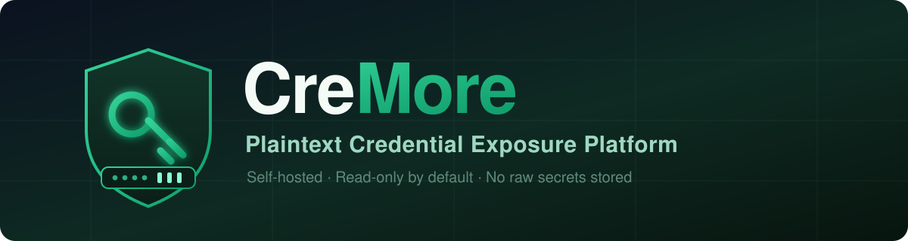
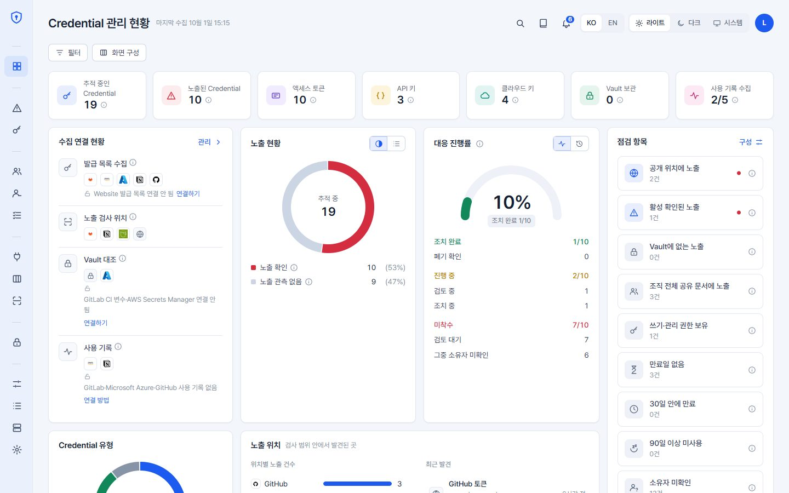
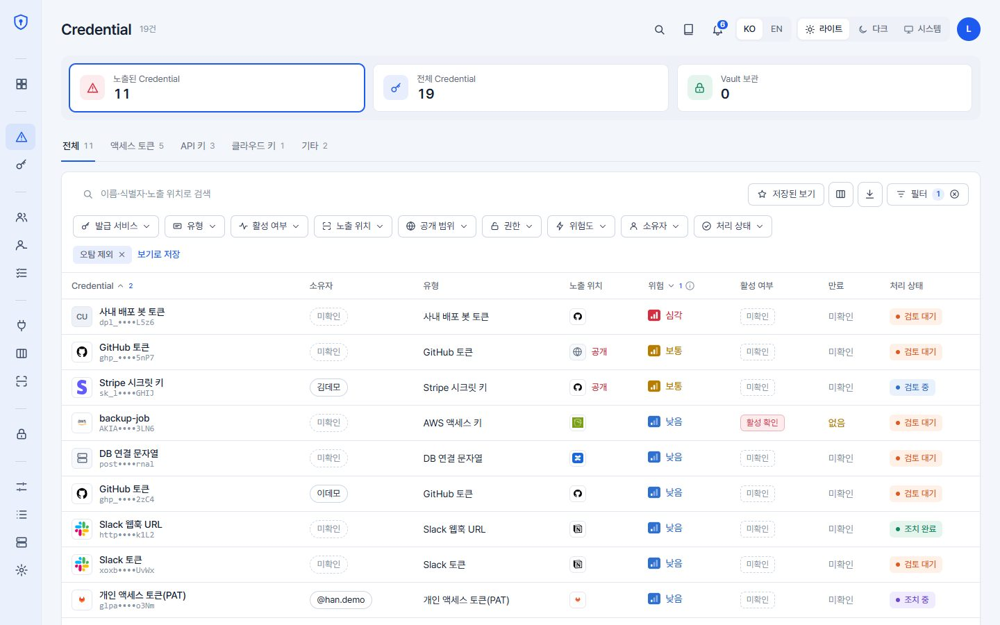
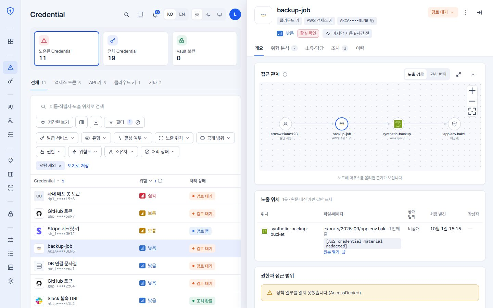
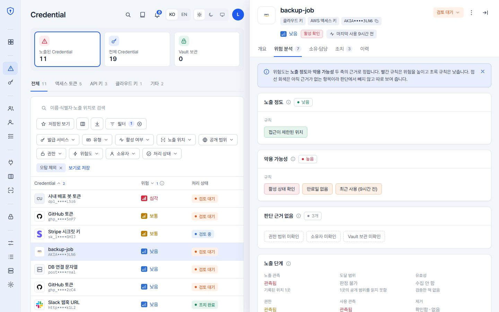
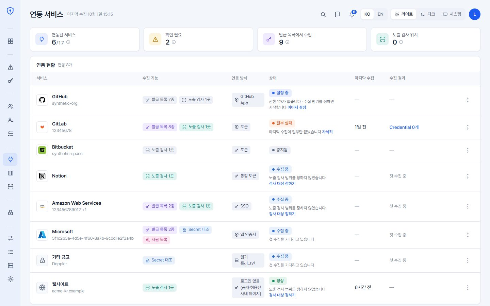
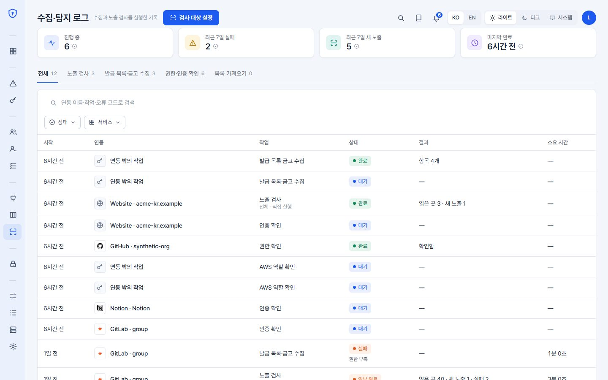
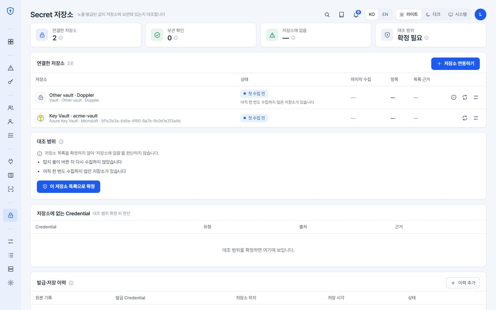
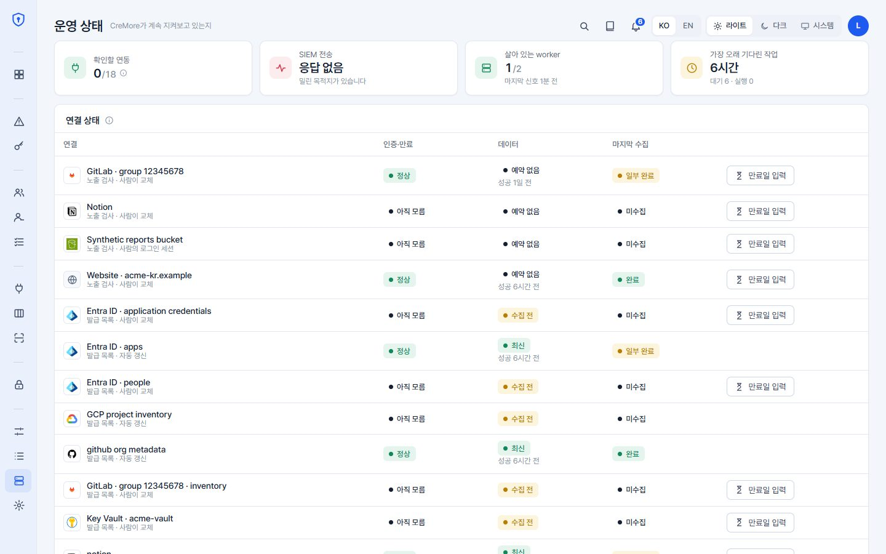

<p align="center">
  
</p>

<p align="center">
  <strong>Find plaintext credentials exposed across cloud storage, code hosts and workspaces, and check them against your vaults — with masked evidence and explainable risk.</strong>
</p>

<p align="center">
  <a href="#1-about-the-project">About CreMore</a> •
  <a href="#2-getting-started">Getting Started</a> •
  <a href="#3-usage">Usage</a> •
  <a href="#5-screenshots">Screenshots</a> •
  <a href="https://github.com/kigma00/CreMore/issues">Report Bug</a> •
  <a href="SECURITY.md">Report a Vulnerability</a>
</p>

<p align="center">
  
  
  
  
  
  
  
  
</p>

---

## 목차 (Table of Contents)

- [About the Project](#1-about-the-project)
  - [Why CreMore?](#why-cremore)
  - [Features](#features)
  - [Technologies](#technologies)
- [Getting Started](#2-getting-started)
  - [Prerequisites](#prerequisites)
  - [Install (Docker Compose)](#install-docker-compose)
  - [Scanning AWS](#scanning-aws)
- [Usage](#3-usage)
- [Architecture](#4-architecture)
  - [Development](#development)
- [Screenshots](#5-screenshots)
- [CreMore's Vision](#6-cremores-vision)
- [License](#7-license)
- [Contact](#8-contact)
- [Release Notes](#9-release-notes)

---

# [1] About the Project

## Why CreMore?

### CreMore는 조직의 자격증명 노출과 공급자 메타데이터를 수집하고, 마스킹된 증거와 위험도로 대응을 돕는 자체 호스팅 보안 플랫폼입니다.

CreMore의 콘텐츠 탐지는 AWS S3, GitHub, Notion에서 승인된 범위만 읽습니다. Slack은 자격증명 메타데이터와 알림에 사용합니다. **수집한 비밀 원문은 메모리에서만 처리하고 설치별 HMAC fingerprint와 필요한 메타데이터·마스킹된 증거만 저장합니다.** 공급자에 접속하기 위해 관리자가 입력한 인증 자격증명은 별도의 봉인 저장 계약을 따릅니다.

### CreMore가 제공하는 핵심 가치:

* **원문 없는 증거 (No Raw Secrets)**
  일반 콘텐츠 탐지에서는 마스킹된 줄과 keyed fingerprint만 남기고, "원본 열기"는 담당자 본인의 공급자 권한으로 열립니다.

* **설명 가능한 위험 점수 (Explainable Risk)**
  악용 가능성, 자격증명 영향도, 권한 범위, 노출 정도 4개 축으로 0–100점을 산출하고, 각 축의 근거를 함께 보여줍니다.

* **실제 검증과 권한 확인 (Verify & Prove)**
  발견된 키를 공급자에 검증해 활성 여부를 기록하고(옵션), AWS 키는 **스캐너 역할로 IAM 정책을 읽어** 실제 부여된 권한까지 보여줍니다. 발견된 키로 조회하지 않습니다.

* **승인 기반 대응 (Approval-gated Remediation)**
  스캐너와 조치 권한을 분리하고, AWS 키 비활성이나 회전은 별도 승인과 배포 게이트가 켜져 있을 때만 실행됩니다. 기본은 모두 꺼짐입니다.

* **정직한 커버리지 (Honest Coverage)**
  직접 확인한 위치의 노출만 제거로 표시하며, 검사하지 못한 범위는 `PARTIAL`로 남깁니다. 스캔이 로그인 만료 등으로 멈추면 "대기 중" 상태와 사유, 다음 시도를 명시합니다.

* **금고 보관 대조 (Vault Coverage)**
  공급자가 보고한 발급 목록, 평문 노출, 기업 금고를 대조해 자격증명마다 금고에 보관되어 있는지, 보이지 않는지, 판단할 수 없는지를 구분합니다. 금고 값은 메모리에서 지문으로만 비교하고 저장하지 않습니다.

## Features

* **자격증명 탐지** — 공개 문서 기반 탐지기, RE2 정규식, base64/UTF-16/escape 디코딩. 연결별 승인 범위와 읽기 한도를 적용합니다.
* **공급자 메타데이터** — schema 2 어댑터는 GitHub, Notion, Slack을 지원합니다. AWS 수집은 별도 경로를 사용합니다. 수집 가능한 객체·권한·값 접근은 공급자별 계약에 따르며, 값은 연결의 capability·옵션·승인 범위를 모두 켠 경우에만 읽어 메모리에서 지문화합니다. 수집한 비밀 원문은 저장하지 않습니다.
* **금고 보관 대조** — AWS IAM·CloudTrail과 공급자 발급 목록, 평문 노출, 금고(AWS Secrets Manager·SSM Parameter Store)를 대조해 노출·발급 자격증명마다 금고 보관 확인·미발견·판단 불가를 나눕니다. 금고 값은 고객 환경의 `cremore-coverage` CLI가 읽고, AWS Secrets Manager·SSM은 관리자가 켜면 CreMore worker가 수동 또는 설정한 주기로 읽습니다. 값이나 해시를 주지 않는 발급 목록은 판단 불가로 남습니다.
* **CloudTrail 로그 수집** — Event History 또는 기존 trail의 S3 로그에서 STS 발급·사용 이벤트를 모읍니다. S3 로그는 CloudTrail 경로 형식(`AWSLogs/[<조직 ID>/]<계정 ID>/CloudTrail/<리전>/<날짜>/`)을 따라 계정·리전·기간의 파일만 읽으므로, 조직 전체 prefix를 모든 계정에 같이 써도 각 계정은 자기 로그만 읽습니다.
* **멀티 계정 AWS 온보딩** — IAM Identity Center(모든 IdP), IAM role, IAM user 실행 신원을 승인하고, 계정마다 세 가지 접근 방식 중 하나로 닿습니다: 배포한 읽기 전용 scanner role(`ROLE`), 실행 신원 자신의 계정(`RUNTIME_IDENTITY`), 또는 **아무것도 배포하지 않고** Identity Center 권한 세트가 자격증명을 발급하는 `SSO_PERMISSION_SET`. AWS Organizations나 Identity Center 할당에서 계정을 찾아 등록할 수도 있습니다. 조사, 조치는 각 자격증명이 속한 계정에서 실행.
* **자격증명 메타데이터** — 인증 주체, 생성, 최근 사용, CloudTrail 관측 사용, IAM 정책상 실제 권한과 선별 시뮬레이션. GitHub/Notion은 공급자가 보고한 권한 범위. 노출된 GitHub 토큰은 Enterprise 감사 로그의 토큰 해시로 사용 기록(최근 7일 Git 이벤트 포함)과 연결합니다. 어느 쪽도 현재 유효성 검증은 아닙니다.
* **GitHub 조직·Enterprise 관리정보** — GitHub App(App ID 또는 Client ID)으로 수집하며 매 수집 첫 요청(`GET /app`)에서 키가 설정한 App의 것인지 확인합니다. 읽기 항목별 필요 App 권한과 조직별 설치 상태를 보여 주고, 자격증명을 수집하지 않고 한 조직의 설치 재확인이나 App 설치 목록 새로고침만 할 수 있습니다. Enterprise 감사 로그는 봉인한 classic PAT로만 읽고, 감사 기록이 가리키는 자격증명을 정확한 식별자로만 연결해 관계별로 봅니다. Actions 실행 기간, 읽을 감사 로그, Enterprise만 읽기, 실행 시간 상한을 연결마다 정합니다.
* **관리정보 수집 제어** — 어느 공급자의 수집이든 일시중지·재개·중지할 수 있습니다(일시중지는 실행 시작 후 최대 6시간). 실행 상세에서 source별 결과와 사유를 한국어·영어 문구로 보고, 공급자 고유 형식(native export)을 JSON으로 받습니다.
* **GitHub Enterprise Server 지원** — 연결에 엔터프라이즈 호스트를 지정하면 검증, 권한 실측, 원본 링크가 그 호스트를 사용. 옵션으로 교차 호스트 검증.
* **무인·변경 감지 스캔** — 로그인한 사람이 없어도 승인된 모든 범위를 매일 전체 검사합니다(기본 하루 1번, 범위마다 02:00~06:00 KST 사이의 고정 시각에 나눠 시작). 공급자 변경 피드·큐 구독·Notion 웹훅으로 바뀐 곳만 바로 검사하고, 서로 다른 연결의 실행은 여러 작업 프로세스에서 동시에 진행됩니다. 바뀌지 않은 객체는 다시 내려받지 않습니다.
* **스캔 운영 UX** — 승인 범위의 최초, 증분, 대조 스캔, 실시간 진행 게이지와 실제 검사 시간, 배제(변경 없음/미지원) 상세, 실패 시 대상별 코드 토글, 중복 스캔 방지, 로그인 대기 상태 안내, 변경 조회가 계속 실패하는 연결의 운영 상태 경고.
* **문서 형식** — PDF, DOCX·XLSX·PPTX, 옛 DOC·XLS·PPT, HWP·HWPX, ODF, RTF와 ZIP·TAR·gzip 등 압축 안의 텍스트를 문서마다 분리된 프로세스에서 시간·메모리 한도 안에 추출해 검사합니다. 이미지·영상 속 글자(OCR)와 7z·RAR은 검사하지 않습니다([문서 스캔](docs/DOCUMENT_SCANNING.md)).
* **Slack 탐지 알림** — 새 노출·새 위치·재노출·심각도 상승을 보안팀 Slack 채널로 바로 알립니다. 비밀값·가린 값·지문은 보내지 않고 콘솔 상세 링크를 붙입니다([Slack 알림](docs/SLACK_ALERTS.md)).
* **대응 요청과 소유자 승인** — 노출된 자격증명의 대응을 담당자에게 Slack DM·메일의 CreMore 링크로 요청하고, 담당 팀의 Slack 채널에도 올려 진행 상황을 스레드에 남깁니다. 담당자는 회사 로그인 후 조치 결과를 보고하고, 키 조치는 소유자가 같은 방식의 링크로 승인합니다. 회사 티켓 시스템은 설치형 플러그인으로 붙습니다([소유자 승인과 대응 요청](docs/TICKET_SYSTEMS.md)).
* **격리 배포** — API·수집·조치·제어·SIEM 실행 역할을 컨테이너와 DB 권한으로 나눠 띄우는 Compose(`deploy/compose/isolated`)·Helm 구성을 제공합니다([침해 이후 피해 제한](docs/POST_COMPROMISE_CONTAINMENT.md)).
* **배포 환경을 못 건드려도 쓸 수 있음** — 조사 기능, 예약 실행, 전용 큐, 오탐 자동 처리, S3 Inventory 연결은 대시보드에서 관리자가 켭니다. 환경변수는 그 기능을 허용하거나 잠글 뿐이고, 모든 변경은 누가 언제 했는지 기록됩니다.
* **역할 분리와 감사** — OIDC 기반 Viewer, Analyst, Remediator, Admin, finding·연결 검증·조치 이력과 설정의 최종 변경자 기록.
* **경계와 한도** — 객체 크기, 요청 수, 시간·바이트 예산, 읽기 전용 기본 연결, 복구 가능한 DB 작업 큐.

자세한 경계와 지원 범위는 [아키텍처 문서](docs/ARCHITECTURE.md), 전체 API 경로는 [API 문서](docs/API.md)를 참고하세요.
금고 보관 대조의 판정 기준과 수집 경로는 [자격증명 보관 대조 문서](docs/CREDENTIAL_COVERAGE.md), 공급자별 구현 상태와 검증 범위는
[공급자 인벤토리 구현 기록](docs/PROVIDER_INVENTORY_IMPLEMENTATION.md)과 각 공급자 디렉터리의 README에 있습니다.

## Technologies

CreMore는 다음 오픈소스 기술로 구축되었습니다:

### 백엔드 (API, Worker)
* **Python 3.12+**, **FastAPI** (REST API), **SQLAlchemy** + **PostgreSQL** (내구성 있는 작업 큐, 상태)
* **boto3** (AWS API와 실행 신원), **httpx** (공급자 HTTP 접근)

### 프론트엔드 (Console)
* **Next.js 16.3.8**, **React 19**, **TypeScript 5.8**, 콘솔 전용 CSS 하나(light/dark 토큰)와 Pretendard

### 배포, 운영
* **Docker Compose** (1인 자체 호스팅 · 팀 SSO 공개 배포), **Helm** (Kubernetes 운영 배포), **oauth2-proxy** (OIDC)

AWS뿐 아니라 회사 VM·물리 서버·Kubernetes에도 설치할 수 있습니다. 사내 서버의 AWS 수집은
[기계 신원](docs/MACHINE_IDENTITY.md)의 OIDC → 단기 STS 자동 갱신을 사용하며 개인 SSO 로그인을 요구하지 않습니다.
서버 설치 장소와 수집 대상 계정은 별개입니다. 비밀 봉인 마스터는 AWS KMS 또는 회사 Vault/OpenBao 등
기존 지원 저장소를 사용할 수 있습니다. 공급자별 무인 인증과 실제 제약은
[인증·운영 지원표](docs/AUTH_FIRST_ONBOARDING_DESIGN.md#설치-장소와-무인-인증)를 참고하세요.
* **AWS IAM Identity Center**, **CloudFormation** (멤버 계정 scanner/remediation role)

---

# [2] Getting Started

## Prerequisites

가장 빠른 실행에는 **Git**과 **Docker**만 있으면 됩니다.

* **Windows, macOS**: Docker Desktop
* **Linux**: Docker Engine + Compose v2

이미지는 x86-64와 ARM64(Apple Silicon Mac, ARM Linux) 모두 빌드됩니다. Docker Compose 방식은 호스트의 Python, Node.js, PostgreSQL을 사용하지 않습니다. 코드를 직접 개발한다면 Python 3.12+, Node.js 20.9+와 npm, PostgreSQL이 추가로 필요합니다.

지원하는 연동 대상은 **GitHub, AWS, Notion, Slack**입니다. 콘텐츠 검사는 GitHub 저장소,
AWS S3, Notion 페이지를 대상으로 합니다. 잠금 파일은
`uv pip compile pyproject.toml --universal --python-version 3.12 --generate-hashes --no-header -o requirements.txt`로
재생성할 수 있습니다.

> ⚠️ 본인이 관리하거나 명시적으로 허가받은 계정, 저장소만 스캔하세요. Docker Compose 구성은 이 PC(`localhost`)에서만 열리는 **1인 운영용**입니다. 여러 사람이 로그인하는 공용 서버에서 실행하거나 인터넷에 노출하지 마세요.

## Install (Docker Compose)

### 1. 저장소 받기

```bash
git clone https://github.com/kigma00/CreMore.git
cd CreMore
```

특정 릴리스를 그대로 받으려면 태그를 지정하세요: `git clone --branch v0.1.0 …`

### 2. 로컬 비밀값 만들기

`.env`를 만들고 비밀값 세 개와 AWS 로그인 연결을 채웁니다. `.env`는 Git에서 제외됩니다.
아래 명령은 **토큰 캐시 디렉터리 생성까지 함께** 합니다. Compose는 호스트 경로를 스스로
만들지 않습니다(`create_host_path: false`) — Linux에서 Docker가 root 소유로 만들면 정작
AWS CLI가 자기 토큰을 못 쓰기 때문입니다. `aws sso login`을 한 번도 안 했다면 이 디렉터리는
아직 없고, 없을 때 동작이 플랫폼마다 다릅니다. Linux 데몬은 컨테이너 기동을 거부하고
(`bind source path does not exist`), Docker Desktop은 대신 만들어 줍니다. 직접 만들어 두는
것이 세 OS에서 동일하게 동작하는 유일한 방법입니다.

**macOS, Linux (Bash/zsh):**

```bash
mkdir -p ~/.aws/sso/cache ~/.aws/login/cache
printf 'API_ADMIN_TOKEN=%s\nPOSTGRES_PASSWORD=%s\nFINGERPRINT_KEY=%s\nAWS_REGION=us-east-1\n' \
  "$(openssl rand -hex 32)" "$(openssl rand -hex 32)" "$(openssl rand -hex 32)" > .env
# 내 AWS CLI 로그인을 컨테이너에 연결합니다. 이게 없으면 AWS 패널이 전부 잠깁니다.
printf 'AWS_CONFIG_DIR=%s/.aws\nAWS_PROFILE=\n' "$HOME" >> .env
# 컨테이너가 내 계정 권한으로 ~/.aws 를 읽도록 합니다 (macOS·Linux 필수).
printf 'CREMORE_UID=%s\nCREMORE_GID=%s\n' "$(id -u)" "$(id -g)" >> .env
```

**Windows PowerShell:**

```powershell
mkdir "$env:USERPROFILE\.aws\sso\cache", "$env:USERPROFILE\.aws\login\cache" -Force | Out-Null
function New-Hex([int]$Bytes) {
    $buffer = [byte[]]::new($Bytes)
    $rng = [System.Security.Cryptography.RandomNumberGenerator]::Create()
    try { $rng.GetBytes($buffer) } finally { $rng.Dispose() }
    [BitConverter]::ToString($buffer).Replace('-','').ToLowerInvariant()
}
# Docker 는 절대 경로에 슬래시(/)를 씁니다. CREMORE_UID/GID 는 Windows 에서 불필요합니다.
$AwsDir = "$($env:USERPROFILE.Replace('\','/'))/.aws"
@"
API_ADMIN_TOKEN=$(New-Hex 32)
POSTGRES_PASSWORD=$(New-Hex 32)
FINGERPRINT_KEY=$(New-Hex 32)
AWS_REGION=us-east-1
AWS_CONFIG_DIR=$AwsDir
AWS_PROFILE=
"@ | Set-Content -Encoding ascii .env
```

`AWS_PROFILE`을 비우면 `~/.aws/config` 의 `[default]` 프로필로 실행됩니다. 다른 프로필을
쓰려면 그 이름을 적으세요. CreMore 는 액세스 키를 묻지 않습니다 — 이 프로필이 해석되는
신원을 읽어서 대시보드에서 **승인만** 받습니다.

`FINGERPRINT_KEY`는 정확한 hex 문자열이어야 하며, 운영에서는 최소 32 random bytes(64 hex 문자)가 필수입니다.
**나머지 설정은 `.env`에서 하지 않습니다.** 조직 자동 등록, 읽기 전용 조사, 예약 실행, 전용 큐, 오탐 자동 처리는 모두 대시보드에서 관리자가 켜고 끄며 기본은 꺼짐입니다. [`.env.example`](.env.example)에 있는 것은 그 기능을 **허용하거나 아예 잠그는** `*_MODE` 값과, 설정에 값을 고정하고 싶을 때 쓰는 선택적 핀뿐입니다.

### 3. 실행

```bash
docker compose up --build -d
docker compose ps
```

| 서비스 | 주소 |
| --- | --- |
| 대시보드 | http://localhost:3100 |
| API | http://localhost:18080 |
| Health check | http://localhost:18080/healthz |

API 인증에는 `.env`의 `API_ADMIN_TOKEN`을 사용합니다. 데이터베이스는 `postgres-data` named volume에 유지됩니다. 대시보드는 `localhost`, `127.0.0.1`, `[::1]`로 접속할 때만 동작합니다(DNS 리바인딩 방어).

새 데이터 볼륨으로 설치하면 계정·연결·탐지 결과가 없는 상태에서 시작합니다. 로컬 `.env`, DB 볼륨, 탐지 캐시와 실행 결과는 GitHub나 배포 이미지에 포함되지 않습니다. 기존 볼륨을 재사용하면 그 안의 데이터는 유지되므로 새 설치와 구분하세요. 문서 스크린샷은 합성 데이터로 만든 것이고 운영 DB에 데이터를 추가하지 않습니다.

### 4. (선택) 대시보드 토큰을 매번 새로 만들기

`API_ADMIN_TOKEN`은 이 설치의 공유 인증 토큰입니다. `.env`에 적어두면 무기한 남고
자동 회전 기능은 없습니다. **매 기동마다 새로 만들어 쉘로 넘기면 `.env`에 새 값을 기록하지 않고 실행할 수 있습니다.** Docker의 컨테이너 설정에는 남을 수 있습니다.

Compose는 쉘 환경을 `.env`보다 우선하고, 이 값 하나가 `api`·`worker`·`web` 세
서비스에 모두 전달되므로 셋이 항상 일치합니다. 대시보드는 이 토큰을 알아서 붙이므로,
직접 API를 호출할 때만 값이 필요합니다.

**macOS, Linux:**

```bash
API_ADMIN_TOKEN="$(openssl rand -hex 32)" docker compose up -d
```

**Windows PowerShell:**

```powershell
$env:API_ADMIN_TOKEN = New-Hex 32   # 위 2단계에서 정의한 함수
docker compose up -d
Remove-Item Env:API_ADMIN_TOKEN
```

토큰은 위 생성 명령을 다시 실행해 컨테이너를 재생성할 때 바뀝니다. 기존 컨테이너의
`restart`는 저장된 환경을 재사용합니다. 쉘에서 지워도 Docker의 컨테이너 설정에서는
지워지지 않습니다. 여러 replica에는 같은 토큰을 일관되게 배포해야 하며, 팀 배포는
공유 관리자 토큰 대신 `AUTH_MODE=oidc`를 사용합니다.

### 5. (선택) 봉인 키의 보관 위치 분리하기

대시보드에 입력한 공급자 토큰은 **봉인 키**로 암호화되어 DB에 저장됩니다. 아무것도
설정하지 않으면 그 키는 `FINGERPRINT_KEY`에서 파생되고, 따라서 `.env` 사본 하나로 저장된
토큰을 복호화할 수 있습니다. 별도 봉인 키와 OS 키체인을 사용하면 `.env`에 평문 키를
적지 않아도 됩니다. 다만 컨테이너에 환경변수로 전달된 키는 Docker 설정에 남을 수 있습니다.

컨테이너는 호스트의 DPAPI·Keychain·Secret Service에 접근할 수 없습니다. 그래서 키는
**호스트에서 꺼내 환경변수로** 넘깁니다. Compose는 쉘 환경을 `.env`보다 우선하므로,
`.env`에 `SEALING_KEY`를 쓰지 않아도 이 값이 사용됩니다.

**macOS** — 키체인에 한 번 넣고, 매번 꺼내 쓰기:

```bash
security add-generic-password -a "$USER" -s cremore-sealing -w "$(openssl rand -hex 32)" -U
SEALING_KEY="$(security find-generic-password -s cremore-sealing -w)" docker compose up -d
```

**Linux** — `secret-tool`(libsecret-tools)과 실행 중인 키링이 필요합니다:

```bash
openssl rand -hex 32 | secret-tool store --label='CreMore sealing key' service cremore-sealing
SEALING_KEY="$(secret-tool lookup service cremore-sealing)" docker compose up -d
```

**Windows PowerShell** — DPAPI로 보호합니다. 내장 기능만 쓰며, 파일이 남지만 그 안에
평문은 없고 **이 Windows 계정으로만** 복호화됩니다:

```powershell
$Key = New-Hex 32   # 위 2단계에서 정의한 함수
ConvertTo-SecureString -String $Key -AsPlainText -Force | ConvertFrom-SecureString |
  Set-Content -Encoding ascii "$env:USERPROFILE\.cremore-sealing"
Remove-Variable Key

# 실행할 때마다
$env:SEALING_KEY = [pscredential]::new('x',
  (Get-Content "$env:USERPROFILE\.cremore-sealing" | ConvertTo-SecureString)).GetNetworkCredential().Password
docker compose up -d
Remove-Item Env:SEALING_KEY
```

**키링도 없다면 — 암호문구.** 헤드리스 리눅스 서버를 SSH로만 쓰는 경우 위 세 가지가
적합하지 않을 수 있습니다(`secret-tool`은 키링 세션이 필요합니다). 이 경우 암호문구를
입력해 `.env`에 직접 기록하지 않는 방법도 있습니다.

```bash
read -rs -p "CreMore sealing passphrase: " SEALING_PASSPHRASE
export SEALING_PASSPHRASE && docker compose up -d && unset SEALING_PASSPHRASE
```

최소 12자입니다. salt는 `FINGERPRINT_KEY`에서 파생되므로 같은 문구라도 설치가 다르면
다른 키가 됩니다. 새 컨테이너를 만들 때 같은 문구를 다시 공급해야 합니다. 기존 컨테이너의
자동 재시작은 저장된 환경을 재사용할 수 있으므로, 이 방법을 메모리 전용 보관으로 보아서는 안 됩니다.

키체인이나 암호문구를 쓰더라도 **AWS를 쓰고 있다면** `SEALING_KMS_KEY_ID`로 키를 KMS에
두는 편이 더 낫습니다. 무인 재시작이 되고 세 OS에서 똑같이 동작합니다. 선택 기준은
[`docs/CREDENTIAL_ROOTS.md`](docs/CREDENTIAL_ROOTS.md)에 있습니다.

## Scanning AWS

S3를 스캔하거나 AWS 자격증명·금고를 조사하려면 이 PC에 이미 로그인한 AWS CLI 자격증명을 그대로 씁니다. AWS를 쓰지 않으면(예: GitHub·Notion·Slack만 연결) 이 단계는 필요 없습니다. 장기 액세스 키 대신 **IAM Identity Center**를 권장합니다.

```bash
# 1) SSO 프로필 구성 후 로그인
aws configure sso
aws sso login --profile <프로필 이름>

# 2) 토큰 캐시 폴더를 만들고 .env에 위치, 프로필을 추가
mkdir -p ~/.aws/sso/cache ~/.aws/login/cache
printf 'AWS_CONFIG_DIR=%s\nAWS_PROFILE=%s\n' "$HOME/.aws" "<프로필 이름>" >> .env

# 3) 다시 시작
docker compose up -d
```

Compose는 설정, 자격증명 파일을 읽기 전용으로 마운트하고 토큰 캐시만 쓰기 가능하게 해서, 세션이 유효한 동안 토큰이 자동 갱신됩니다. Identity Center 세션이 끝나면 PC에서 `aws sso login`을 다시 실행하세요 — 대기 중이던 AWS 스캔이 자동으로 이어집니다.

### 여러 사람이 함께 쓰려면

기본 Compose는 **1인용**입니다. `AUTH_MODE=local`이라 공유 토큰 하나가 곧 신원이고, 감사 로그의 수행자가 전부 같은 사람이 됩니다. 보안팀이 함께 쓰려면 둘 중 하나를 고릅니다.

| | 쿠버네티스 없이 | 쿠버네티스로 |
|---|---|---|
| 배포 | Compose + 공개 overlay | Helm 차트 (`deploy/helm`) |
| 구성 | `deploy/compose/reverse-proxy/` | `values.yaml`의 `auth.oidc` |
| 경로 | Caddy(TLS) → oauth2-proxy(OIDC 로그인) → web → API | Ingress → oauth2-proxy → web → API |

둘 다 **같은 OIDC 모델**입니다. 사용자의 bearer를 API까지 전달하고, API가 issuer·JWKS 서명·audience·만료를 직접 검증한 뒤 groups claim을 역할(Viewer/Analyst/Remediator/Admin)로 매핑합니다. 매핑된 그룹이 하나도 없는 사용자는 **인증 자체가 거부**되므로 감사 로그에 주체로 남지도 않습니다. 이 모드에서는 `API_ADMIN_TOKEN`으로 로그인할 수 없습니다.

쿠버네티스 없이 쓰는 쪽:

```bash
cp deploy/compose/reverse-proxy/.env.public.example .env.public
# PUBLIC_HOST와 OIDC_* 값을 채운 뒤
docker compose --env-file .env --env-file .env.public   -f docker-compose.yml -f deploy/compose/reverse-proxy/compose.public.yml up -d
```

값이 하나라도 비면 **기동하지 않습니다**. 약한 모드로 공개되는 것보다 실패하는 쪽이 낫기 때문입니다. 자세한 설정은 [reverse-proxy README](deploy/compose/reverse-proxy/README.md)에 있습니다.

**AWS 접근은 달라집니다.** IAM Identity Center 방식에는 `aws sso login`으로 시작한 쓰기 가능한 토큰 캐시와 만료 시 사람의 재로그인이 필요합니다. 무인 공유 서버에는 멤버 계정 역할(CloudFormation)을 권장합니다. 공개 Compose overlay는 SSO discovery를 잠그고, Helm은 기본 비활성입니다. Helm에서 `config.ssoDiscoveryMode=enabled`를 선택하려면 별도로 캐시 volume/mount와 운영 절차를 준비해야 하며, 값 변경만으로 로그인 캐시가 만들어지지는 않습니다.

---

# [3] Usage

배포 후 콘솔(`/`) 사용 순서(권장 역할 분리: `Viewer`, `Analyst`, `Remediator`, `Admin`):

1. **연동** — Admin이 **연동 서비스**에서 GitHub, AWS, Notion, Slack 중 하나를 고르고 연결 마법사에서 용도(노출 검사·발급 목록·Secret 저장소·조치 등)와 인증 방식을 정해 연결합니다. 토큰은 CreMore가 암호화(AES-256-GCM)해 저장하고, 비밀 저장소를 쓰면 `vault://<path>` 참조를 넣습니다. S3는 AWS 계정 역할로 읽습니다.
2. **권한 점검** — 마법사의 마지막 단계에서 CreMore가 인증 주체와 읽기 권한을 확인합니다. 나중에는 연동 메뉴의 **권한 다시 확인**으로 다시 점검합니다.
3. **검사 대상** — Admin이 연동 메뉴의 **검사 대상 설정**에서 catalog를 갱신하고 검사할 저장소·페이지·버킷/prefix만 고릅니다. 저장한 정확한 범위가 승인된 scope profile이 되며, 연결했다고 조직 전체가 자동으로 스캔되지 않습니다.
4. **수집·스캔** — 승인한 범위는 매일 전체 검사(기본 02:00~06:00 KST 사이 범위별 시각)와 변경 감지 스캔이 자동으로 돌고, 연동 메뉴의 **지금 수집**으로 바로 실행할 수도 있습니다. **수집·탐지 로그**에서 진행·검사 시간·배제 항목·실패 사유를 봅니다. Analyst 이상은 여기서 실행을 멈추거나 다시 실행합니다.
5. **결과 검토** — **노출된 Credential**·**Credential 목록**에서 행을 열면 상세 패널에 마스킹된 증거, 위험 근거, 메타데이터·권한, 사용 내역, "원본 열기" 링크가 있고, 오탐·해결을 기록합니다. 담당자와 부서는 **담당자 및 부서 배정**에서 정하고, 상세 패널의 **대응 요청**으로 담당자에게 Slack DM·메일 링크를(필요하면 담당 팀 채널에도) 보냅니다. 담당자는 링크에서 회사 로그인 후 조치 결과를 보고하고, 이후 검사가 제거를 확인합니다.
6. **Secret 저장소 대조 (옵션)** — **Secret 저장소**에서 발급 목록(AWS IAM·CloudTrail 등)과 금고(AWS Secrets Manager·SSM)의 대조 결과를 봅니다. 금고 값은 연결마다 한 번 보여 주는 제출 토큰으로 고객 환경의 `cremore-coverage`가 보내거나, 서버 수집을 켠 AWS 금고는 CreMore worker가 직접 읽습니다. 결과는 자격증명마다 금고 보관 확인·미발견·판단 불가와 그 근거로 표시됩니다.
7. **발급 목록·메타데이터 (옵션)** — 마법사에서 발급 목록 용도를 켠 연결(GitHub App, AWS, Notion, Slack)의 수집 결과는 **Credential 목록**과 **메타데이터 수집 현황**에 모입니다. 퇴사자가 소유한 자격증명은 **퇴사자 Credential**에서 봅니다.
8. **동작 설정** — Admin이 **환경 설정**에서 공급자 검증(기본 켜짐; 발견한 키를 발급 공급자에 보내 활성 여부를 확인하므로 공급자 활동 로그에 남습니다), 교차 호스트 확인, 스캔 시작 조건(매일 전체 검사 주기·시작 시각, 변경 감지, 큐 구독)과 Slack 탐지 알림을 정하고, **연동 서비스**의 기타 설정에서 연락 발송(Slack 봇·메일·콘솔 주소)과 대응 알림 채널을 정합니다. AWS의 읽기 전용 조사(실제 사용 내역·잠재 접근 권한·Secrets Manager 인벤토리)는 **연동 서비스**의 AWS 설정에서 켭니다. 각 변경은 **Audit Log**에 남습니다.
9. **대응 (옵션)** — Remediator가 상세 패널의 조치 탭에서 조치 계획을 요청하고 다른 Admin이 **조치 승인**에서 승인하면 같은 plan hash로 실행을 요청합니다. 소유자 승인이 필요한 조치(키 비활성화·삭제·새 키 게시, 관리자가 이 요구를 끄지 않은 설치)에서는 키 소유자의 승인(Slack·메일 링크, 로컬 설치는 운영자 기록)도 기다리며, 공개 노출된 키는 Admin이 사유를 남기고 바로 비활성화한 뒤 소유자에게 알릴 수 있습니다. 실제 변경은 설치 정책에서 명시적으로 켠 경우에만 실행됩니다.

---

# [4] Architecture

```
CreMore/
├── cremore/                     # Python API, Worker (탐지 엔진 포함)
│   ├── api/                 # FastAPI 앱, 대시보드 라우트, finding 증거, 거버넌스
│   ├── detection/           # 탐지기 카탈로그, 정규식, 디코더, 공급자 검증
│   ├── collectors/          # 승인 범위의 콘텐츠 수집기·공통 계약
│   ├── coverage/            # schema 1/2 공통 수집 런타임·등록·저장소·금고 보관 대조
│   ├── scanning/            # 오케스트레이터, scope 승인, 재점수화
│   ├── investigation/       # AWS 조사 기존 import 호환 경로
│   ├── remediation/         # 승인 기반 AWS 키 조치
│   ├── governance/          # 대응 요청(Slack·메일 링크·팀 채널), 조사 기록, 플레이북
│   ├── risk/                # 설명 가능한 위험 점수 모델
│   ├── secretstore/         # Vault/OpenBao 참조 해석, 봉인 토큰
│   ├── sources/             # 공통 검증·명시적 등록·기존 import 호환 경로
│   ├── siem/                # 발견 이벤트·영속 발신 대기열·SIEM 출력 어댑터
│   ├── domain/              # 도메인 모델, 연결 의미론
│   ├── db/                  # PostgreSQL 저장소, 작업 큐(task store)
│   ├── worker/              # 리스 기반 스캔 실행 런타임
│   └── cli/                 # API, Worker, coverage, SIEM exporter, token refresher 진입점
├── web/                     # Next.js 콘솔 (React, TypeScript), / 에서 열림
│   ├── app/                 # 콘솔 route group(page·layout·console.css·글꼴), healthz, 서버 프록시
│   ├── console/             # 콘솔 셸·데이터·레이어·공통 UI와 views/<화면>/
│   ├── components/          # locale·theme·표시 시간대·API 코드 문구
│   └── lib/                 # API 클라이언트·세션·순수 타입·스캔 범위 모델
├── aws/                    # backend/ Python 라이브러리
├── github/                 # backend/
├── notion/                 # backend/
├── slack/                  # Enterprise Grid 앱 발급 목록 backend/
├── deploy/                  # docker-compose(1인·팀 SSO·격리), Helm 차트, CloudFormation
├── docs/                    # ARCHITECTURE, API, 스크린샷, 로고
└── docker-compose.yml
```

**주요 구성 요소**

* **Detection Engine** — 프로젝트 자체 Python 구현(Apache-2.0). 원문은 탐지 경계를 넘지 않고 `SanitizedDetection`만 통과합니다.
* **Account Sessions** — 자격증명이 속한 계정에서만 읽기 전용 세션을 열고, 승인, 신원, 재검증을 매 호출마다 확인합니다.
* **Task Store** — 리스 소유권 기반의 내구성 있는 스캔 작업 큐. 크래시, 로그인 만료에도 체크포인트에서 이어집니다.
* **Governance Projection** — 저장된 증거만으로 검증, 소유, 사용 사실을 대시보드 계약에 맞춰 투영합니다(공급자 재호출 없음).
* **SIEM Exporter** — 신규 finding과 같은 트랜잭션에서 비밀 원문 없는 이벤트를 저장하고 별도 프로세스가 목적지별로 전송·재시도합니다. JSONL·HTTPS JSON·Splunk HEC·Falcon LogScale을 지원하며, 설치된 출력 플러그인을 명시적으로 활성화할 수 있습니다. [설정·지원 범위](docs/SIEM_INTEGRATION.md)를 확인하세요.

개발·확장은 [팀 AI 코딩 지침](docs/AI_TEAM_CODING_GUIDE.md), 이번 구조 변경과 검증 결과는
[리팩터링 보고서](docs/REFACTOR_REPORT.md)를 참고하세요. `api/app.py`는 조립을 담당하고,
연결 비밀 입력·HTTP 경계·finding 라우트는 각각 소유 모듈에 있습니다. 콘솔의 공통
타입·계산은 React 화면에서 분리되어 있으며(`web/lib/`, 화면의 `model.ts`), 대화상자·상세 패널·메뉴는
`web/console/layer.tsx`가 소유합니다. 스타일은 `web/app/(console)/console.css` 하나의 토큰을 씁니다. 두 개발 지침의 절별 근거는
[요구사항 대응표](docs/REFACTOR_REQUIREMENTS_MATRIX.md)에 있습니다(2026-09 리팩터링 당시 기록이라 이후 삭제한 대시보드 파일을 가리킵니다).

현재 권한과 저장소는 설치 단위입니다. 공급자 tenant 표시는 SaaS 고객 격리를 뜻하지 않으며,
일부 목록·통계는 전체 자료를 읽고 콘텐츠 스캔은 설치당 하나로 제한됩니다.
고객별 격리나 대규모 조회 서비스에는 추가 설계와 부하 검증이 필요합니다.

콘텐츠 수집과 메타데이터 수집은 서로 다른 계약입니다. 콘텐츠 공급자의 설정·작업 변환·
수집기 조립과 연결 폼을 정하는 onboarding descriptor는 `<vendor>/backend/cremore_<vendor>_provider/`의
공급자 모듈이 소유하며 공통 registry가 명시적으로 연결합니다. 콘솔은 그 descriptor로 연결 화면을 그립니다. 단일 제품에서 라이브러리 함수를
호출하며 공급자별 별도 서버는 없습니다. 팀별 구현은 이 경계에서 병렬로
개발합니다. 새 인증·범위·공개 응답·DB 작업 종류의 계약은 플랫폼 담당자와 함께 확장합니다.
기존 metadata 설명은 각 공급자의 `descriptor.py`가 소유하고 비교 호출은 `CollectorRuntime`으로
통일합니다. [디렉터리·함수 호출·통합 지점](docs/PROVIDER_DIRECTORY_REVIEW.md)을 확인하세요.
수집 모듈과 설치형 SIEM 출력 플러그인은 별도 계약입니다. 설정·theme token·provider 주입을
지원하며 공개 header/sidebar 교체 API는 없습니다.
OIDC 로그인과 세션 cookie는 oauth2-proxy가, 인증 전달은 Next 서버 프록시가,
사용자 권한 검증은 Python API가 담당합니다.

## Development

Python 3.12+ 가상환경에서 시작하세요. 아래 각 명령 블록은 저장소 루트 기준입니다.
`dev` extra에는 Ruff가 포함됩니다.

```bash
python -m pip install -e ".[dev]"
python -m ruff check cremore aws/backend github/backend notion/backend slack/backend
```

현재 저장소의 자동 테스트 코드는 제거되어 있습니다. PostgreSQL 동시성 검사는 격리한 일회용 DB의
`CREMORE_TEST_POSTGRES_URL`로 별도 실행하며 운영 DB를 사용하지 않습니다.

```bash
cd web
npm ci --ignore-scripts
npx tsc --noEmit
npm run build
```

브라우저 검사는 Google Chrome이 필요합니다. Node.js 최소 버전은 20.9이며,
CI는 22.23.2를 사용합니다.
Helm·wheel 검사와 환경별 조건은
[팀 지침의 검증 명령](docs/AI_TEAM_CODING_GUIDE.md#10-테스트빌드-명령)을 참고하세요.
Ruff의 기존 진단, 환경별 skip, 로컬·원격 CI의 실행 결과는
[리팩터링 보고서](docs/REFACTOR_REPORT.md)에 구분해 기록합니다.
변경 전에는 [기여 지침](CONTRIBUTING.md)과 해당 디렉터리의 `AGENTS.md`도 확인하세요.

---

# [5] Screenshots

화면은 합성 데이터로 만든 예시입니다. 현재 브라우저 검사는 `web/tests/console-proof.cjs`와
각 검사에서 필요한 최소 입력을 실행 중에 만들며, 저장된 API 응답 파일을 사용하지 않습니다.

## Credential 관리 현황 (Overview)

<p align="center">
  
</p>

## 노출된 Credential (Exposed credentials)

<p align="center">
  
</p>

## Credential 상세 패널 (Credential panel)

<p align="center">
  
</p>

## 위험 분석 (Risk analysis)

<p align="center">
  
</p>

## 연동 서비스 (Integrations)

<p align="center">
  
</p>

## 수집·탐지 로그 (Collection & detection logs)

<p align="center">
  
</p>

## Secret 저장소 (Secret stores)

<p align="center">
  
</p>

## 운영 상태 (Operations)

<p align="center">
  
</p>

---

# [6] CreMore's Vision

### "노출된 자격증명을, 원문 없이 안전하게"

**증거는 남기되, 비밀은 남기지 않는다**
탐지 결과가 새로운 유출 지점이 되어서는 안 됩니다. CreMore는 마스킹된 증거와 fingerprint만으로 대응할 수 있게 하여, 보안 도구 자체가 위험이 되지 않도록 합니다.

**최소 권한과 정직한 커버리지**
읽기 전용을 기본으로 하고, 확인하지 못한 것을 확인한 것처럼 말하지 않습니다. 스캔이 멈추면 왜 멈췄는지, 무엇을 배제했는지 담당자에게 그대로 보여줍니다.

**누구나 자체 호스팅**
Apache 2.0 오픈소스로 자신의 인프라에서 운영하고 원문 없는 수집 결과를 보관할 수 있습니다. 공급자 검증을 켜면 발견한 자격증명을 발급 공급자에 전송합니다. 과거 GCP 원문 저장 기능을 사용한 설치는 [기존 값·백업 정리 절차](docs/integration/GCP_TOTAL_GUIDE_KO.md#과거-원문-저장-설치의-이관)를 별도로 수행해야 합니다.

---

# [7] License

이 프로젝트는 **Apache License 2.0** 라이선스 하에 배포됩니다. 자세한 내용은 [LICENSE](LICENSE) 파일을 참조하세요.

탐지 엔진은 프로젝트 자체 Python 구현이며, 제3자 secret-scanning 실행 파일이나 탐지 카탈로그를 재배포하지 않습니다. 공개 배포 시 [THIRD_PARTY_NOTICES.md](THIRD_PARTY_NOTICES.md)의 고지를 보존하고 자체 법률 검토를 수행하세요.

---

# [8] Contact

* **버그·제안**: [GitHub Issues](https://github.com/kigma00/CreMore/issues)
* **취약점 신고**: 공개 이슈로 열지 마세요. 저장소의 **Security → Report a vulnerability**(GitHub 비공개 취약점 신고)를 사용합니다. 절차와 범위는 [SECURITY.md](SECURITY.md)에 있습니다.
* **기여**: [CONTRIBUTING.md](CONTRIBUTING.md)

CreMore는 오픈소스 보안 프로젝트입니다. 기여와 제안을 환영합니다.

---

<p align="center">
  <strong>CreMore — Credential Exposure, handled without the raw secret.</strong>
</p>

---

# [9] Release Notes

## 2026-10-12 — Slack 대응 요청·GLPI 제거·업그레이드 직후 검사 정리

* **Slack·메일 링크 대응 요청**: 노출 대응 요청을 담당자에게 Slack DM 또는 메일의 CreMore 링크(7일 유효)로 보냅니다. 담당자는 회사 로그인 후 CreMore에서 조치 결과를 보고하고, 그 보고가 응답(완료는 승인, 미완료·예외는 거절)을 함께 기록합니다. 요청받은 사람(확인된 이메일, 사람 목록의 같은 활성 사용자)만 열 수 있으며 CreMore 역할은 필요 없습니다. 로컬 설치는 운영자가 회신을 기록합니다.
* **팀 채널과 스레드 진행 기록**: 관리자가 승인한 담당 팀의 기존 Slack 채널에도 담당자를 멘션해 올리고, 그 스레드에 진행 상황(응답, 제거 확인, 재노출, 완료, 다시 요청, 링크 만료)을 정해진 문장으로 남깁니다. 채널은 저장·발송·스레드 기록 때마다 봇 권한 `channels:read`·`groups:read`로 다시 확인하며, 기본은 비공개 채널만이고 다른 회사와 공유한 채널과 보관된 채널은 거절합니다. 스레드 댓글은 응답으로 읽지 않습니다.
* **GLPI 제거**: 내장 GLPI 티켓 시스템과 시험 구성을 지웠습니다. 티켓 시스템은 설치형 플러그인으로만 붙고, DB 이관 15가 GLPI 설정과 봉인된 자격증명을 지웁니다.
* **업그레이드 직후 검사**: 매일 전체 검사가 범위마다 02:00~06:00 KST 사이의 고정 시각에 나눠 시작하고, 업그레이드 시각은 DB 이관 14가 DB 시계로 기록합니다. 문서 추출 방식이 바뀌어 생기는 재검사는 업그레이드 뒤 첫 전체 검사가 끝날 때까지 미뤄 한 번에 읽고, 그 사이의 변경 검사는 전체 읽기로 바뀌지 않습니다.

검증 범위는 합성 client·fake Slack 전송과 로컬 검사입니다: 전체 pytest(일회용 PostgreSQL) 11,525 통과·95 skip, 웹 단위 338·타입 검사·빌드·브라우저 검사 31. 실제 Slack 워크스페이스·메일·IdP와 실제 담당자 응답은 포함하지 않습니다. 상세는 [소유자 승인과 대응 요청](docs/TICKET_SYSTEMS.md)과 [스캔 속도·무인 스캔 기록](docs/SCAN_PERFORMANCE_2026-10-09.md) 13절을 참고하세요.

## 2026-10-09 ~ 10-11 — 스캔 속도·문서 형식·무인 검사·병렬 처리·Slack 탐지 알림

* **무인 검사**: 로그인한 사람이 없어도 승인된 모든 범위를 매일 전체 검사하고(관리자가 주기·시작 시각을 정하거나 끔), 새 연동은 변경 감지 스캔(피드·큐·웹훅)이 기본으로 켜집니다. 변경 조회가 1시간 넘게 실패하는 연결은 운영 상태에 경고로 나옵니다.
* **속도**: 바뀌지 않은 객체는 다시 내려받지 않고, 저장소·페이지 소스는 바뀐 것만 읽으며, 다음 객체를 미리 겹쳐 내려받습니다(합성 측정 읽기 2.05초 → 0.27초). 탐지기 선택을 한 번의 검색으로 줄이고 Notion은 페이지당 요청 1회로 읽습니다.
* **문서 형식**: 문서마다 미리 올린 서버에서 fork한 프로세스로 추출하고(문서당 약 340ms → 5~9ms, POSIX), 실행 파일·옛 Office·HWP 3·CP949 텍스트까지 읽습니다.
* **병렬 처리**: worker 컨테이너 하나가 작업 프로세스 여러 개를 돌리고, 같은 버킷·저장소·페이지는 동시에 두 번 읽지 않습니다. Helm worker 메모리 기본값은 3Gi, DB `max_connections`는 200입니다.
* **Slack 탐지 알림**: 새 노출·새 위치·재노출·심각도 상승을 Incoming Webhook 또는 연락 발송의 Slack 봇으로 알립니다. AWS 키는 사용 기록 조회가 저장한 최근 사용 출처도 표시합니다.

측정 방법과 남은 한계는 [스캔 속도·문서 형식·무인 스캔·병렬 처리·Slack 알림 설계와 측정](docs/SCAN_PERFORMANCE_2026-10-09.md)에 있습니다.

## 2026-10-03 ~ 10-08 — 격리 배포·공급자 조사 확장·연결 마법사 정리

* **격리 배포**: API·수집·조치·제어·SIEM 역할을 컨테이너·DB 권한·자격증명 봉인 키로 나눠 띄우는 Compose와 Helm 구성을 추가했습니다. IAM Roles Anywhere 무인 갱신을 지원합니다.
* **공급자 조사**: AWS 잠재 접근 권한을 주체 정책이 가리키는 리소스에서 시뮬레이션하고(지정한 KMS 키는 키 정책까지 읽음), 금고 대조는 별도 값 읽기 역할로 읽습니다. GCP 키의 계정 접근은 Policy Troubleshooter로, Azure 앱 자격증명은 앱 권한·Entra 역할·Azure 역할과 함께 봅니다. GitHub Enterprise 인벤토리를 이어 받을 수 있는 export로 수집하고, 사람 목록은 조직의 SAML 신원을 읽습니다.
* **연결 마법사**: 공급자마다 공식 문서가 요구하는 권한만 묻고 각 권한이 여는 것을 설명하도록 고쳤습니다. Notion은 서명된 페이지 변경 웹훅으로 변경 검사를 접수합니다.

## 2026-09-27 — GitHub 관리정보 확장·수집 제어·Atlassian OAuth 계약·UI 보완

* **GitHub 관리정보**: GitHub 담당자의 독립 수집기(develop_github)에만 있던 기능을 제품 구조로 옮겼습니다 — 감사 로그의 다음 페이지 링크 처리, 안정적인 자격증명 식별자, Actions 실행 기간·감사 범위·Enterprise만 읽기 옵션, 봉인한 classic PAT로 읽는 Enterprise 감사 로그, App ID 또는 Client ID와 `GET /app` 신원 확인, 읽기 항목별 필요 권한과 조직별 설치 상태, 자격증명을 수집하지 않는 설치 확인, 감사 기록과 자격증명의 정확한 연결 보기.
* **수집 제어**: 관리정보 수집의 일시중지·재개·중지와 실행 시간 상한. 일시중지는 실행 수명(6시간) 안에서만 열어 두고, 실행이 열리기 전의 일시중지도 같은 시간이 지나면 작업을 끝내 연결의 다음 수집을 막지 않습니다.
* **검토 후 수정**: GitHub App 연결 점검이 스캔 승인 범위를 다시 검토 대상으로 만들던 문제, 옵션 추가로 기존 연결의 저장 이력·비교·재수집이 거부되던 문제, 설치 확인이 20번을 넘으면 조직 목록이 비던 문제, 잘못된 App 키가 부분 완료로 끝나던 문제 등을 고쳤습니다. 해석할 수 없는 Enterprise 감사 PAT는 이제 감사 읽기만 실패시킵니다.
* **CloudTrail S3 로그**: 설정한 prefix 아래 전체를 읽던 것을 CloudTrail 경로 형식대로 계정·리전·기간만 읽도록 바꿨습니다. 합성 측정에서 계정 20개 조직의 한 계정 수집 요청이 21,922회에서 33회로 줄었고, 계정 100개에서 객체 한도로 실패하던 수집이 완료됩니다.
* **Atlassian Cloud OAuth**: 팀원이 확인한 Preview OAuth 계약 수정(#35)을 옮겨진 공급자 구조에 반영했습니다. OAuth 클라이언트 수를 발견한 서비스 계정 ID 배열(요청당 최대 100개)로 요청해 그 계정들의 목록과만 비교하고(이전의 본문 없는 요청은 실제 조직에서 거절됩니다), 지원팀이 확인한 OAuth 배열 응답은 페이지 계약 미확인으로 표시하며, API 토큰의 발급자·계정 정보를 보존합니다.
* **화면**: 실행 상세의 native export 받기, 관리정보 사유·작업 오류의 한국어·영어 문구(코드 병기), 연결 폼의 선택 비밀 역할 표시, 감사 연결 보기의 한도 안내를 추가했습니다.
* **정리**: 제품에 필요 없는 GCP 독립 CLI(평문 Secret 내보내기·watcher 포함)와 GitLab 독립 수집기를 삭제했습니다. `cremore_gcp`에는 제품이 쓰는 식별자·값 reader·매칭 함수만 남습니다.

검증 범위는 합성 client와 로컬 검사입니다: 전체 pytest(일회용 PostgreSQL 17) 6736 통과·59 skip(Windows에서 돌 수 없는 POSIX 검사), 웹 단위 517·타입 검사·빌드. 실제 GitHub·AWS·Atlassian 계정 수집, 브라우저 화면 확인, 원격 CI는 포함하지 않습니다. 변경과 검증의 상세는 [SaaS 구조 통합 기록](docs/integration/SAAS_STRUCTURE_INTEGRATION_KO.md) 4.9절을 참고하세요.

## 2026-09-26 — 금고 보관 대조·Azure·GitHub 근거 확장

* **금고 보관 대조 판정**: 중지한 금고 연결은 대조 범위에서 빠지고, GCP 서비스 계정 키는 키 ID로 금고 미관측을 판정합니다. 발급 자격증명을 금고 판정별로 세고 근거 종류로 거를 수 있으며, 확인한 Key Vault 인증서에 없는 Entra 인증서도 표시합니다.
* **서버 금고 수집**: AWS Secrets Manager·SSM Parameter Store와 이 설치의 Vault/OpenBao는 관리자가 켜면 CreMore worker가 수동 또는 설정한 주기로 수집합니다. 값은 메모리에서 지문화하며 저장하지 않습니다.
* **Azure**: Azure Blob Storage와 Azure DevOps Repos(Services·Server, 지정 브랜치, TFVC)를 콘텐츠 소스로 스캔하고, Azure DevOps 조직의 PAT 발급 목록을 수집합니다. Azure DevOps Git 발견에는 탐지한 커밋에 고정한 원본 링크를 만듭니다(TFVC·Blob은 링크 없음). 노출된 SAS가 어느 Storage 키로 서명됐는지 계정 SAS와 Blob·Queue·Table·Files 서비스 SAS에서 오프라인으로 확인합니다.
* **탐지기**: Microsoft Entra client secret(현행 형식과 설정 이름 옆의 이전 형식), Azure Storage SAS, Azure DevOps PAT를 추가해 기본 탐지기는 867개입니다.
* **GitHub·GitLab 근거**: 노출된 GitHub 토큰을 Enterprise 감사 로그의 토큰 해시로 사용 기록과 연결하고(최근 7일 Git 이벤트 포함), 검증이 보고한 소유자의 발급 토큰을 먼저 보여 줍니다. GitLab.com 토큰을 정확히 식별하고, 발급처가 확인되지 않은 GitLab 토큰은 GitLab.com으로 검증 요청을 보내지 않습니다.
* **증분 스캔**: 변경 없음으로 나온 S3 객체와 Notion 페이지의 노출도 마지막 관측 시각을 갱신합니다.
* **화면**: Azure 공급자·자격증명 종류 이름, Azure 연결의 신고 폼, Blob 연결의 인증 방식 표시, 원본 링크가 없는 Azure 발견 위치의 안내, GitHub Git 이벤트 안내를 바로잡았습니다.

검증 범위는 합성 client와 로컬 검사(Python 전체 pytest, 웹 단위·빌드·브라우저 검사)입니다. 실제 Azure·GitHub Enterprise·AWS·Vault 계정 수집, Docker 이미지 재빌드, 원격 CI는 포함하지 않습니다. 커밋별 변경과 검증은 [공급자 인벤토리 구현 기록](docs/PROVIDER_INVENTORY_IMPLEMENTATION.md)을 참고하세요.

## 2026-09-24 — 유지보수 경계·개발 검증 보완

* 기능·공통 UI·화면 골격별로 CSS 소유자를 나누고, 테마 생성과 브라우저 검사가 앱의 stylesheet 순서를 함께 사용하도록 정리했습니다.
* 순수 체크포인트 규칙의 DB 의존을 제거하고, 메타데이터 페이지 조회와 공통 경로·탐지 규칙의 중복을 줄였습니다. AWS 승인 revision과 감사 기록도 보강했습니다.
* 최신 FastAPI의 입력 검증 오류 처리에 맞춰 호환성을 수정하고, 개발 설치에 JSON Schema·날짜 형식 검사 의존성을 명시했습니다.
* 실제 공급자 추가 절차·설정·공개 경계·확장 한계를 [팀 AI 코딩 지침](docs/AI_TEAM_CODING_GUIDE.md)에 정리했습니다. 절별 근거는 [요구사항 대응표](docs/REFACTOR_REQUIREMENTS_MATRIX.md), 검증 상태와 남은 제약은 [리팩터링 보고서](docs/REFACTOR_REPORT.md)를 참고하세요.

## 2026-09-23 — 전체 코드 경계·정확성 리팩터링

* API 조립, 화면 모델, 공급자 인벤토리, 반복 페이지 처리의 책임을 정리했습니다.
* 대화상자의 불투명 패널·스크롤, 오래된 비동기 응답, 부분 스캔 접수와 이력 오류 표시를 수정했습니다.
* 설정·티켓·조치의 원자적 갱신, 재개 커서·예산, 안전한 오류와 마스킹, 불완전한 증거의 판정을 보강했습니다.
* 공개 경로·CLI·봉인 읽기 형식을 유지했습니다. 실제 검증 수치·제약과 소스 규모는 [리팩터링 보고서](docs/REFACTOR_REPORT.md)에 기록했습니다. 이번 검증은 합성·로컬 검사이며 실계정 수집이나 배포를 포함하지 않습니다.

## 2026-09-22 — GitLab 수집기 v0.11.1 연동

* **수집기 업데이트**: 통합 플랫폼의 GitLab 수집기를 v0.6.0에서 v0.11.1로 갱신하고, 기존 10개 Credential 계열의 메타데이터 수집을 유지합니다.
* **성능·안정성 개선**: 자산 탐색·토큰 수집을 우선 처리하고, 사용자 상세 조회 전용 속도 제한과 대기 중 다른 작업 처리를 적용했습니다. 작업 큐 조회와 중복 진단 기록 처리도 개선했습니다.
* **감사 설정 연결**: 대시보드의 `audit` 선택이 실제 감사 수집 옵션에 반영되도록 수정했습니다. 기존 연결의 감사 기간 설정은 유지합니다.
* **감사 메타데이터 보존**: 토큰별 생성 근거·조회 범위·미확인 사유를 schema 1.4에 기록하고, DB 저장·대시보드 조회·JSON 내보내기 사이의 필드 누락을 수정했습니다.
* **당시 검증 기록**: 관련 백엔드 회귀 테스트 389개와 UI 테스트 463개 통과 및 로컬 GitLab 수집 결과가 기존 연동 보고서에 기록되어 있습니다. 이 과거 기록은 이번 리팩터링에서 실계정으로 재검증한 결과가 아닙니다.

검증 범위는 로컬 GitLab 연동과 위 회귀 테스트이며, 다른 SaaS의 실계정 검증이나 운영 서버 배포를 의미하지 않습니다. [상세 연동·검증 기록](docs/integration/gitlab-adoption.md)을 참고하세요.

### 후속 CI 안정화

* AWS 계정 자동 탐색이 서버 시작 직후에도 첫 실행을 수행하도록 수정했습니다.
* 모바일 오류 목록의 가로 넘침과 화면 전환 완료 전에 판정하던 브라우저 테스트를 보완했습니다.
* GCP 서비스 계정 도메인 판정과 URL 관련 테스트를 수정하고, Compose의 기본값 생략을 검사에 반영했습니다.
* 의존성 감사에서 PyPI에 없는 로컬 애플리케이션만 제외하고 설치된 외부 의존성과 잠금 파일의 엄격한 검사는 유지합니다.
* GitHub CI·CodeQL 상태는 [Actions](https://github.com/kigma00/CreMore/actions)의 대상 commit별 실행 결과로 확인합니다. 로컬 검사와 원격 실행 결과는 구분합니다.
