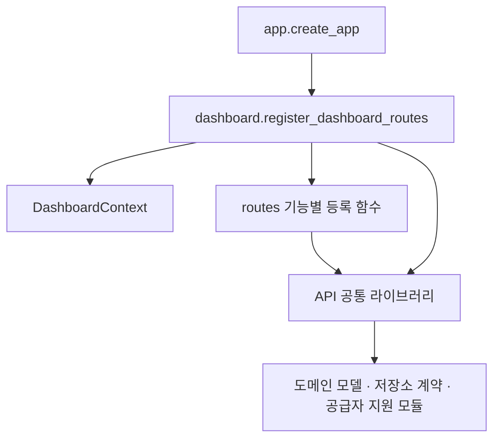

# API 공통 라이브러리 사용 안내

`cremore.api.dashboard`에 있던 재사용 로직을 책임별 모듈로 분리했다.
53개 함수와 관련 상수의 기존 동작을 유지하면서, HTTP 라우트가
대형 등록 함수의 내부 구현에 의존하지 않도록 한다.

이 모듈들은 기존 `cremore` Python 패키지에 포함된다. 별도 서비스나
별도 배포 패키지를 설치할 필요가 없다. FastAPI를 사용하는 API 계층
라이브러리이며, 공급자 수집기 자체를 외부 SDK로 배포하는 변경은 아니다.

## 수정할 위치

| 책임 | 모듈 | 주요 진입점 |
| --- | --- | --- |
| HTTP 오류·UUID 검증·시각·로그 표시·행위자 참조 | `cremore.api.http_support` | `http_error`, `parse_uuid`, `isoformat`, `utc_now`, `log_safe`, `actor_uuid` |
| 연결 비밀 입력·봉인·참조 검증 | `cremore.api.connection_credentials` | `connection_secret` |
| 기본 finding HTTP 경로 | `cremore.api.finding_routes` | `register_reads`, `register_triage` |
| 소스 목록·scope/config 변환 | `cremore.api.source_contract` | `config_from_scope`, `scope_ref`, `provider_to_source` |
| 연결 인증 상태·수집/스캔 작업 응답 | `cremore.api.source_presenters` | `present_connection`, `present_job` |
| 발견 항목·담당자 검토 응답 | `cremore.api.finding_presenters` | `present_finding`, `present_owner_review` |
| 탐지기·크리덴셜 종류 카탈로그 | `cremore.api.detection_catalog` | `detector_catalog`, `credential_type_catalog` |
| 사용자 정의 규칙 입력·응답 | `cremore.api.rule_payloads` | `rule_from_body`, `present_rule` |
| 관리 선언·거버넌스 응답 | `cremore.api.governance_presenters` | `clean_declaration`, `governance_item_source`, `present_review` |
| AWS 연결 준비·계정 세션·메타데이터 조회 지원 | `cremore.api.aws_support` | `open_account_session`, `secrets_inventory_session`, `access_key_metadata`, `sign_in_diagnosis` |
| 역할에 따른 통합 검색 | `cremore.api.search_service` | `search_payload` |
| 라우트 의존성 계약 | `cremore.api.route_context` | `DashboardContext` |

새 기능을 추가할 때 해당 모듈을 직접 import한다. 공급자 고유 API 수집과
정규화는 `<vendor>/backend/cremore_<vendor>_provider/metadata/`에서 구현한다.
`cremore/coverage/providers/`는 명시적 등록·공통 검증과 기존 import 호환 경로를
소유한다. 공급자 라이브러리도 루트 `pyproject.toml`의 단일 wheel에 포함된다.
HTTP 응답을 만드는 책임과 공급자에게 요청을 보내는 책임을 섞지 않는다.

## 의존 방향



- `app.py`는 실제 서비스와 인증 의존성을 선택한다.
- `dashboard.py`는 애플리케이션 단위의 서비스·콜백을 구성한다.
- `routes/`는 요청 처리·권한 확인·응답 반환을 담당한다.
- 공통 라이브러리는 `app.py`, `dashboard.py`, `routes/`를 import하지 않는다.
- 라이브러리를 import하는 것만으로 API 앱을 생성하거나 라우트를 등록하거나
  공급자 네트워크 요청을 실행하지 않는다. AWS 조회 함수는 호출할 때만 I/O를 수행한다.

## 재사용 예시

```python
from cremore.api.source_contract import config_from_scope
from cremore.api.source_presenters import present_connection
from cremore.domain.models import Connection

connection = Connection(
    provider="bitbucket",
    name="실습 저장소",
    config=config_from_scope("bitbucket", "workspace/repository"),
)
payload = present_connection(connection)
assert payload["profile_ref"] == "workspace/repository"
```

이 예시는 API 서버나 DB를 실행하지 않는다. `present_connection`은 기존
응답 계약에 따라 인증 참조를 가리고 관측된 인증 상태를 변환한다.
연결 상태를 변환하는 함수 자체가 새로운 인증 검증을 수행하지는 않는다.

저장소를 사용하는 서비스에는 저장소 인스턴스를 명시적으로 전달한다.

```python
from cremore.api.search_service import search_payload

result = search_payload(repo, role="viewer", q="example", limit=20)
```

`repo`는 애플리케이션이 관리하는 저장소다. 검색 서비스가 전역 DB 연결을
생성하지 않으며, 기존 역할별 검색 제한과 부분 결과 의미를 유지한다.

## 라우트 의존성

`DashboardContext`는 키워드 인자 전용 dataclass다. 필드 누락이나 오타는
컨텍스트 생성 시 오류로 드러난다. `SimpleNamespace`에 임의 속성을
추가하는 방식은 사용하지 않는다.

컨텍스트의 서비스 연결은 고정되지만, 전달된 저장소·서비스의 내부
상태를 불변으로 만드는 것은 아니다. 서비스의 수명은 여전히 앱 단위다.
구체적인 저장소·설정·서비스 타입과 콜백 진입점을 선언했으며, 공급자별
factory의 세부 반환 인터페이스에는 아직 `Any`가 포함된 주입 지점이 남아 있다.
라우트가 실제 사용하는 의존성만 전달한다. 원시 AWS 검사기와 identity 캐시처럼
조립 함수 안에서만 사용하는 값은 해당 함수가 소유하고 컨텍스트에 노출하지 않는다.

라우트에 새 의존성이 필요하면 다음을 같은 변경에 포함한다.

1. `route_context.py`에 필드와 타입을 추가한다.
2. `dashboard.py`의 컨텍스트 생성에서 값을 전달한다.
3. 사용하는 `routes/<area>.py`에서만 해당 필드를 읽는다.
4. 해당 기능의 API 테스트를 실행한다.

재사용 함수가 필요할 뿐이면 컨텍스트 필드를 추가하지 말고 해당 라이브러리에서
직접 import한다. 컨텍스트는 앱 수명이 있는 서비스와 의존성 주입용 콜백을 위한 것이다.

## 기존 코드 호환

- `from cremore.api import create_app`는 기존 함수와 동일한 객체를 반환한다.
  최초 접근 시 앱 모듈을 로딩하므로 함수의 원래 시그니처도 유지된다.
- 기존 `dashboard._dashboard_connection`, `dashboard._dashboard_finding`,
  `dashboard.search_payload` 등의 경로는 같은 함수의 호환 alias로 남겨뒀다.
- 새로운 제품 코드는 호환 alias 대신 소유 모듈을 직접 사용한다.
- 테스트에서 함수 전역을 교체해야 한다면 새 소유 모듈을 patch한다.
  예를 들어 연결 만료 시각을 고정하려면 `source_presenters.utc_now`를 교체한다.
  과거 모듈의 alias를 다시 대입하는 것은 새 모듈의 전역을 바꾸지 않는다.
- URL, 라우트 등록 순서, 응답 필드, DB 구조, 수집 범위와 권한은 변경하지 않는다.

## 검증

저장소 루트에서 개발 의존성을 설치한 Python 3.12+ 환경으로 실행한다.
공급자 디렉터리 이동을 받은 기존 환경도 editable install을 갱신한다.

```sh
python -m pip install -e '.[dev,gcp]'
export AWS_EC2_METADATA_DISABLED=true
python -m pytest cremore/api/library_boundaries_test.py -q
python -m pytest cremore/api -q
python -m pytest -q
```

PowerShell에서는 `export` 대신 `$env:AWS_EC2_METADATA_DISABLED='true'`를 사용한다.
마지막 명령은 `pyproject.toml`의 `testpaths`에 따라 공통 코드와 공급자 backend
테스트를 함께 실행한다. 독립 CLI 검사는 [팀 지침](AI_TEAM_CODING_GUIDE.md)의 별도 명령을 따른다.

독립 import 검사는 새로운 Python 프로세스에서 실행한다. 다른 테스트가
미리 앱을 import했기 때문에 역방향 의존을 놓치는 문제를 피하기 위해서다.
기존 API 테스트는 권한·직렬화·연결·작업·라우트 순서의 외부 동작을 검증한다.
리소스 경로 검사도 카탈로그 JSON과 CloudFormation 템플릿의 이동 영향을 확인한다.

후속 분리는 수집기 실행 context, 공통 저장 계약, 앱 단위 scope 서비스처럼
책임과 소비자가 명확한 단위로 진행한다. 동작 변경이나 DB migration을
파일 이동과 같은 PR에 섞지 않는다.
