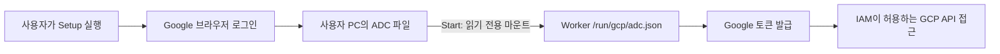

# 다른 개발자를 위한 Worker ADC 설정

각 사용자가 **자기 Google 계정**으로 로그인해 인증 파일을 만드는 절차다. 저장소에는 설정 스크립트만 배포한다. ADC 파일에는 인증 정보가 있으므로 공유하거나 커밋하지 않는다.

## Windows + 로컬 Docker 빠른 시작

Google Cloud CLI가 없거나 `gcloud` 명령을 찾지 못한다면 아래의 **Google Cloud CLI 설치와 명령 인식 오류 해결**부터 진행한다.

준비물: Google Cloud CLI, 실행 중인 Docker Desktop, 접근할 GCP 프로젝트와 IAM 권한. [저장소 README](../../README.md)의 기본 설치에 따라 `.env`의 DB 암호·API 토큰·FINGERPRINT_KEY 등도 먼저 설정한다. 스크립트는 기존 `.env`를 수정하지 않는다.

저장소 루트에서 아래 `YOUR_PROJECT_ID`를 자신의 프로젝트 ID로 바꿔 실행한다.

```powershell
# 1. 브라우저에서 자신의 Google 계정으로 로그인 (최초 설정 또는 재인증)
.\scripts\gcp-adc.ps1 -ProjectId YOUR_PROJECT_ID -Action Setup

# 2. ADC를 Worker에 연결하고 로컬 서비스를 빌드·실행
.\scripts\gcp-adc.ps1 -ProjectId YOUR_PROJECT_ID -Action Start

# 3. 실행 중인 Worker 내부에서 토큰 발급 확인 (토큰은 출력하지 않음)
.\scripts\gcp-adc.ps1 -ProjectId YOUR_PROJECT_ID -Action Check
```

새 PowerShell 창에서도 Start/Check를 그대로 실행하면 된다. 각 실행에서 ADC 파일 경로와 quota project 환경 변수를 다시 설정한다. Setup은 Cloud CLI의 기존 사용자 ADC를 새 로그인으로 갱신하므로 이 컴퓨터의 다른 ADC 사용 도구에도 영향을 줄 수 있다.



기본 파일 위치는 `%APPDATA%\gcloud\application_default_credentials.json`이다. `CLOUDSDK_CONFIG`를 설정한 사용자는 그 디렉터리를 사용한다. 파일은 저장소에 복사하지 않는다. Docker는 `deploy/compose/gcp.yml`을 통해 Worker에만 마운트한다.

## Google Cloud CLI 설치와 명령 인식 오류 해결

### 1. `gcloud`를 찾지 못하는 오류

PowerShell에서 다음 오류가 나오면 CLI가 설치되지 않았거나 설치 경로가 PATH에 반영되지 않은 상태다.

```text
gcloud : 'gcloud' 용어가 cmdlet, 함수, 스크립트 파일 또는 실행할 수 있는 프로그램 이름으로 인식되지 않습니다.
CommandNotFoundException
```

`C:\Windows\System32`에서 실행한 것 자체가 원인은 아니다. `gcloud`는 PATH에 등록되면 어느 디렉터리에서든 실행할 수 있다.

### 2. Windows 설치

1. [Google 공식 Windows 설치 프로그램](https://dl.google.com/dl/cloudsdk/channels/rapid/GoogleCloudSDKInstaller.exe)을 다운로드하고 실행한다.
2. 설치 안내를 따르고, PATH에 추가하는 옵션이 표시되면 선택한다.
3. 설치 후 기존 PowerShell을 닫고 새로 연다. IDE에 내장된 터미널에서 계속 인식되지 않으면 IDE도 다시 실행한다.
4. 다음 명령으로 설치를 확인한다.

```powershell
gcloud --version
```

설치 절차의 최신 내용은 [Google Cloud CLI 공식 설치 안내](https://docs.cloud.google.com/sdk/docs/install-sdk)를 참고한다.

### 3. 설치했는데도 명령을 찾지 못하는 경우

우선 명령 등록 상태를 확인한다.

```powershell
Get-Command gcloud -ErrorAction SilentlyContinue
```

출력이 없다면 설치할 때 선택한 폴더를 확인한다. 기본 사용자 설치 위치를 사용했다면 다음과 같이 실행 파일 존재 여부를 확인할 수 있다.

```powershell
$gcloudPath = Join-Path $env:LOCALAPPDATA 'Google\Cloud SDK\google-cloud-sdk\bin\gcloud.cmd'
Test-Path -LiteralPath $gcloudPath
```

`True`라면 아래처럼 전체 경로로 실행할 수 있다.

```powershell
& $gcloudPath --version
```

또는 해당 PowerShell 세션의 PATH에 폴더를 추가한다.

```powershell
$env:Path = (Split-Path $gcloudPath -Parent) + ';' + $env:Path
gcloud --version
```

`False`라면 사용자 지정 설치 경로를 확인하거나 설치를 완료한다. 위 세션용 PATH 설정은 새 터미널에는 유지되지 않는다. 지속 적용이 필요하면 Windows 사용자 환경 변수의 Path에 **실제로 설치된 `bin` 폴더**를 추가하고 터미널을 다시 연다.

### 4. ADC 로그인과 quota project 설정

아래 명령을 한 줄씩 실행한다. `YOUR_PROJECT_ID`는 자신이 접근할 프로젝트 ID로 바꾼다.

```powershell
gcloud auth application-default login
gcloud auth application-default set-quota-project YOUR_PROJECT_ID
```

첫 명령으로 열린 브라우저에서 해당 프로젝트에 접근 가능한 계정으로 로그인한다. 두 번째 명령까지 오류 없이 끝났는지 확인한다. 일반 `gcloud auth login`만으로는 로컬 ADC 설정을 대신할 수 없다.

프로젝트 ID는 비밀값이 아니지만, 생성된 ADC JSON에는 인증 정보가 포함된다. JSON 내용이나 액세스 토큰을 Git, 이슈, 채팅에 붙여 넣지 않는다. 오류를 공유할 때는 오류 코드와 메시지를 사용한다.

### 5. 현재 실행 방식에 맞게 Worker 연결

- **로컬 Docker**: 앞의 빠른 시작에 있는 `-Action Start`, `-Action Check`를 순서대로 실행한다. 기존 `.env` 설정과 Docker Desktop이 필요하다.
- **Python·Node 직접 실행**: `-Action Start`는 Docker 전용이므로 사용하지 않는다. ADC를 만든 동일한 OS 사용자로 Worker를 실행하고, API와 Worker가 동일한 DB·인증 관련 앱 설정을 사용하도록 구성한다. 다른 사용자나 호스트의 ADC는 자동 공유되지 않는다.
- **원격 서버**: 개발 PC에서 로그인해도 서버 Worker까지 인증되지 않는다. 아래 원격 서버 항목에 따라 실제 실행 환경에 인증을 제공한다.

Python 직접 실행 환경은 공급자 디렉터리 이동을 받은 뒤 저장소 루트에서
`python -m pip install -e ".[gcp]"`를 다시 실행한다. ADC 구현은
`gcp/backend/cremore_gcp_provider/gcp_auth.py`에 있으며 같은 제품 wheel에 포함된다.
`cremore.gcp_auth`는 기존 호출자를 위한 호환 import로 유지된다.

대시보드가 열리거나 웹→API 요청이 성공하는 것과 Worker의 GCP 인증은 별개의 확인 항목이다. ADC 인증 이후에도 대상 프로젝트 접근 점검으로 IAM 권한을 확인해야 한다.

## Linux / macOS에서 로컬 Docker 사용

동일한 준비물을 설치하고 저장소 루트에서 실행한다.

```bash
gcloud auth application-default login
gcloud auth application-default set-quota-project YOUR_PROJECT_ID
export GCP_ADC_FILE="${CLOUDSDK_CONFIG:-$HOME/.config/gcloud}/application_default_credentials.json"
export GCP_QUOTA_PROJECT=YOUR_PROJECT_ID
docker compose -f docker-compose.yml -f deploy/compose/gcp.yml up -d --build api worker web
docker compose -f docker-compose.yml -f deploy/compose/gcp.yml exec -T worker python -c 'from cremore_gcp_provider.gcp_auth import adc_token; adc_token()(); print("ADC authentication succeeded")'
```

새 터미널에서는 두 export 명령을 다시 실행한다.

## 인증 이후와 오류 구분

- Check 성공: Worker에서 토큰 발급 성공. 모든 프로젝트 API의 권한이 검증된 것은 아니다.
- 웹 화면에 수집할 프로젝트를 등록하고 접근 점검 결과를 확인한다. 스크립트의 ProjectId는 quota project이며 웹의 수집 대상 등록을 대신하지 않는다.
- `403`: 실행 계정의 대상 API 권한, API 활성화 여부, quota project의 `serviceusage.services.use` 권한 등을 확인한다. 이 스크립트는 IAM 역할을 부여하거나 API를 활성화하지 않는다.
- `GCP_ADC_NOT_CONFIGURED`: ADC 파일과 Worker 마운트를 확인한다.
- `GCP_ADC_REFRESH_FAILED`: Setup으로 다시 로그인하고 Start로 재생성한 후 Check한다.
- Compose에서 `.env` 변수 오류: 저장소 기본 설치 설정을 먼저 완료한다.
- PowerShell 실행 정책 오류: 조직의 스크립트 실행 정책에 맞게 허용받거나 통합 안내서의 개별 명령을 직접 실행한다.

## 원격 서버에서는

이 도우미의 Start는 기본 **로컬 개발용 Compose**를 실행한다. 공개 서버의 배포 설정을 대체하는 명령으로 사용하지 않는다. 원격 Docker context를 사용하는 경우에도 로컬 파일이 원격 호스트에 자동 복사되지 않는다.

실제 Worker가 있는 호스트·컨테이너에 인증을 제공해야 한다. GCP 운영 환경은 연결된 서비스 계정, 외부 클라우드는 Workload Identity Federation 등 해당 환경의 인증을 구성한다. 브라우저/Cloud Shell/개발 PC의 로그인은 원격 Worker로 자동 전달되지 않는다.

전체 배포와 IAM 설명: [GCP 통합 안내서](GCP_TOTAL_GUIDE_KO.md).

공식 문서: [로컬 ADC 설정](https://docs.cloud.google.com/docs/authentication/set-up-adc-local-dev-environment), [ADC 탐색 순서](https://docs.cloud.google.com/docs/authentication/application-default-credentials).
