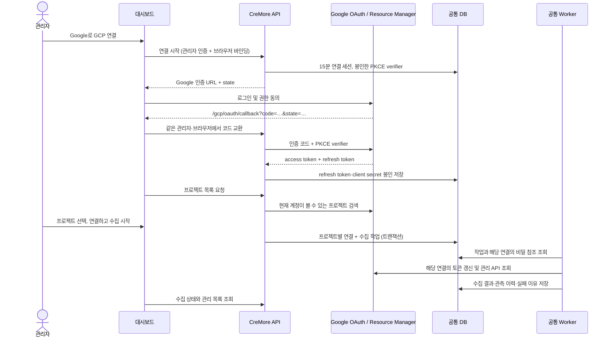

# GCP 대시보드 Google 연결: 설정 및 사용 설명서

## 1. 이번 구현의 범위

`refactoring` 브랜치의 공통 API·DB·Worker와 GCP 라이브러리를 그대로 사용한다. 별도 GCP Worker, GCP 전용 Docker, 서버의 `gcloud` 설치 없이 **관리자의 Google 로그인 → 프로젝트 선택 → 연결 생성 → 수집 예약 → 결과 조회**를 제공한다.

Google OAuth 앱은 설치 관리자가 한 번 등록해야 한다. 코드를 배포하는 것만으로 Google 앱·프로젝트 IAM 권한·API 활성화가 만들어지지는 않는다. 이 기능의 Google 계정 로그인은 CreMore 자체 로그인/OIDC와 별개다. CreMore 관리자로 로그인한 뒤 사용한다.

### 구현 위치

| 책임 | 파일 |
|---|---|
| Google 인증 코드 교환, 토큰 갱신, 프로젝트 목록 | `gcp/backend/cremore_gcp_provider/oauth.py` |
| 관리자의 연결 세션·연결 생성 API | `cremore/api/gcp_oauth.py` |
| DB에 공유되는 임시 연결 세션 | `cremore/coverage/gcp_oauth_store.py` |
| 메타데이터 수집기의 인증 선택 | `gcp/backend/cremore_gcp_provider/metadata/adapter.py` |
| Cloud Storage 인증 주입 | `cremore/secretstore/resolver.py` |
| 콘솔의 Google 로그인 시작·완료(연결 마법사) | `web/console/gcp-oauth.ts`, `web/console/views/integrations/wizard.tsx` |
| Google에서 돌아오는 페이지 | `web/app/(console)/gcp/oauth/callback/page.tsx`, `web/console/gcp-callback.tsx` |

## 2. 연결 구조



OAuth 연결의 토큰이 실패하면 다른 ADC 계정으로 전환하지 않는다. `adc`·`workload_identity` 연결은 기존 인증 방식을 계속 사용한다. 프로젝트마다 연결이 생기므로 범위·주기·성공/부분 성공/실패를 구별할 수 있다.

## 3. 설치 관리자가 한 번 설정할 항목

### 3.1 Google OAuth 앱

1. Google Cloud의 Google Auth Platform에서 앱 브랜딩·대상 사용자·데이터 액세스를 설정한다.
2. OAuth 클라이언트 유형을 **웹 애플리케이션**으로 생성한다. 데스크톱 클라이언트용 ADC 파일을 업로드하는 방식이 아니다.
3. 승인된 리디렉션 URI에 실제 대시보드 주소를 정확히 등록한다.
   - 운영 예: `https://test.cremore.site/gcp/oauth/callback`
   - 로컬 예: `http://localhost:3000/gcp/oauth/callback`
   - `localhost`와 `127.0.0.1`, 포트, 경로는 서로 다르다. 접속 주소와 등록값을 일치시킨다.
4. 앱이 요청하는 scope는 `openid`, `email`, `https://www.googleapis.com/auth/cloud-platform`이다. Cloud scope는 API 인증 범위이며 프로젝트 IAM 권한을 추가하지 않는다.
5. 로그인할 사람이 모두 같은 Google Workspace·Cloud Identity 조직이면 대상을 **내부**로 둔다. 외부 앱을 Testing 상태로 두면 로그인할 계정을 테스트 사용자에 등록해야 하고, 받은 refresh token이 7일 뒤 만료되므로 지속 수집에는 **프로덕션**으로 게시한다.
6. 클라이언트 시크릿은 만들 때 한 번만 보이므로 그때 마법사에 넣는다(잃으면 새 시크릿을 추가한다).
7. OAuth 앱 프로젝트의 Cloud Resource Manager API를 활성화하고, 수집 대상 프로젝트에서 사용할 IAM, API Keys, Secret Manager, Cloud Logging, Cloud Storage API와 권한을 확인한다. 해당 기능만 사용할 때 필요한 API·권한을 부여한다.

계정에 프로젝트 검색 권한이 없거나 Resource Manager API를 사용할 수 없으면 목록 조회가 실패할 수 있다. 이때 프로젝트 ID 직접 입력은 가능하지만, 실제 수집 권한이 생기지는 않는다.

### 3.2 Google 로그인 앱 등록: 대시보드 또는 API 서버 환경변수

**대시보드:** 앱이 등록되지 않았으면 연결 마법사의 Google 로그인 단계가 리디렉션 URI(지금 접속한 대시보드 주소로 채움)·클라이언트 ID·클라이언트 시크릿을 받는다.
Google Auth Platform의 클라이언트에서 웹 애플리케이션 클라이언트를 만들고 그 리디렉션 URI를 등록한 뒤 저장한다(`PUT /api/v2/gcp/oauth/client`).
시크릿은 설치의 봉인 키로 봉인해 설치 설정에 두고 다시 보여 주지 않는다. 저장은 `GCP_OAUTH_CLIENT_SAVED`로 감사 기록되며 서버를 재시작하지 않는다.
주소만 바꿀 때는 시크릿을 비워 두면 저장된 시크릿을 유지한다. 저장한 앱은 마법사의 **Google 로그인 앱 바꾸기**로 바꾼다.

**API 서버 환경변수:** 아래 세 변수 중 하나라도 있으면 환경변수가 우선한다. 대시보드는 사용 중인 클라이언트 ID만 보여 주고 바꾸지 않는다(`GCP_OAUTH_CLIENT_PINNED`).
일부만 설정했거나 값이 잘못됐으면 설정 오류로 표시한다. 설치 관리 도구(Helm Secret 등)로 앱을 고정하려면 이 방식을 쓴다.
환경변수가 없으면 관리자가 대시보드에서 앱을 등록해 Google 로그인을 켤 수 있다. 대시보드에 저장한 앱은 환경변수를 설정한 동안
쓰이지 않고 남아 있다가 환경변수를 지우면 다시 쓰인다.

```dotenv
GCP_OAUTH_CLIENT_ID=YOUR_CLIENT_ID.apps.googleusercontent.com
GCP_OAUTH_CLIENT_SECRET=YOUR_CLIENT_SECRET
GCP_OAUTH_REDIRECT_URI=https://test.cremore.site/gcp/oauth/callback
```

위 값은 **API 서버**에 설정한다. `NEXT_PUBLIC_` 변수나 프런트엔드 번들에 넣지 않는다. OAuth 앱의 client secret과 연결별 refresh token은 API에서 기존 AES-GCM 봉인 저장을 사용한다. API와 Worker는 같은 DB와 같은 봉인 키 설정을 사용해야 한다. 기존 설치의 `FINGERPRINT_KEY`를 새 값으로 바꾸지 않는다. 별도 봉인 키 운용은 `docs/CREDENTIAL_ROOTS.md`를 따른다.

**Docker 없이 실행:** 저장소 루트에서 기존 Python 실행 환경에 `python -m pip install ".[gcp]"`로 새 코드를 설치한다. 기존 API 설정에 위 세 변수를 추가하고 API·Worker를 재시작한다. `cremore-api`, `cremore-worker`는 같은 `DATABASE_URL`·봉인 키를 받아야 한다. Web은 기존 `CREMORE_API_URL`·CreMore 인증 설정을 유지하고 새 소스를 빌드·재시작한다. 자세한 실행 옵션은 루트 README를 따른다. Google OAuth 연결만 사용하면 `gcloud auth application-default login`을 별도로 실행할 필요가 없다.

**Compose:** 루트 `.env.example`의 변수를 로컬의 미추적 설정에 추가하고 API·Worker·Web 이미지를 함께 갱신한다. 기본 Compose는 세 OAuth 변수를 API로 전달하며 Worker에서는 비운다. Worker는 DB의 봉인된 연결별 인증을 읽는다. Google ADC가 필요하지 않으면 `deploy/compose/gcp.yml` overlay를 추가할 필요가 없다.

**Helm:** 이미 존재하는 Kubernetes Secret을 참조한다. 실제 Secret 값은 values 파일에 기록하지 않는다.

```yaml
gcp:
  oauth:
    secretName: cremore-google-oauth
    clientIdKey: client-id
    clientSecretKey: client-secret
    redirectUri: https://test.cremore.site/gcp/oauth/callback
```

`gcp.oauth`는 API에만 주입한다. 기존 `gcp.adcSecretName`·GKE Workload Identity는 계속 선택할 수 있다.

### 3.3 배포·DB·프록시

- API·Worker·Web을 이 브랜치의 같은 버전으로 배포한다. 오래된 Worker는 `google_oauth` 연결 계약을 이해하지 못한다.
- 기존 `create_all` 초기화가 `gcp_oauth_sessions` 테이블과 만료 인덱스를 추가한다. 기존 테이블·인벤토리를 삭제하지 않는다. 배포 전 DB 백업과 기존 마이그레이션 운영 절차를 유지한다.
- 공통 Worker가 실제로 실행되어야 한다. 화면에 작업이 `QUEUED`로 남으면 같은 DB를 사용하는 Worker를 확인한다.
- `/gcp/oauth/callback`은 Web으로 전달한다. CreMore 관리자 인증과 동일한 브라우저 세션을 유지한다. 콜백 경로를 API 인증 우회 경로로 만들지 않는다.
- 콜백 요청의 query에는 일회용 Google 인증 코드가 있다. Ingress·APM·로드밸런서에서 query 및 요청 본문 수집을 제외한다. 저장소의 oauth2-proxy 설정은 request logging을 끈다. 인증·표준 로그는 유지한다. Caddy 예시는 별도 access log를 켜지 않는다.
- 콜백 페이지는 `no-referrer`를 사용하고 읽은 query를 즉시 주소창에서 제거한다. Google 토큰은 브라우저에 반환하지 않는다.

## 4. 콘솔 사용 순서

1. CreMore에 **관리자**로 로그인한다.
2. **연동 서비스**에서 **Google Cloud**를 고르고 연결 마법사에서 용도와 대상(프로젝트·폴더·조직)을 정한다.
3. 인증 방식에서 **Google 로그인**을 고른다. Google 로그인 앱이 없으면 그 자리에서 3.2절의 앱(리디렉션 URI·클라이언트 ID·시크릿)을
   저장할 수 있다. 서버 설정으로 고정한 앱이 올바르지 않다고 나오면 API 서버의 `GCP_OAUTH_*`를 고치고 API를 재시작한다.
4. 요청할 읽기 권한을 확인하고 **Google에서 승인**을 누른 뒤 Google에서 계정을 선택하고 동의한다.
5. Google이 `/gcp/oauth/callback`으로 돌려보내면 콘솔이 인증 코드를 API에 한 번 넘기고 주소에서 지운 뒤 **연동 서비스**의 같은 마법사로
   돌아온다. 마법사가 권한을 확인하고, 필요하면 **권한 다시 확인**으로 다시 본다.
6. 마지막 단계에서 수집 주기 등을 확인하고 연결을 시작한다.
7. **수집·탐지 현황**에서 Worker 작업·최근 실행·실패 사유를, **Credential 목록**과 **메타데이터 수집 현황**에서 결과를 확인한다.
   Google 로그인 성공·작업 예약·실제 API 수집 성공은 각각 다른 단계다.

첫 연결은 API 키 메타데이터, 서비스 계정·키 메타데이터, Secret 항목·버전, 공개키를 수집한다. 키·Secret 값 수집 옵션은 연결의
설정에서 따로 켜며 처음에는 꺼져 있다. 다시 승인해도 기존 값 수집·주기·범위 설정은 유지한다.

### 재인증과 인증 방식 변경

연동 메뉴의 **수집 범위·인증 설정**에서 **Google 로그인**을 고르고 **Google에서 승인**(이미 승인한 연결은 **다른 계정으로 다시 승인**)을
누른다. 같은 연결 ID의 인증을 교체하고 권한을 다시 확인한다. 실행 중인 작업이 있거나 다른 관리자가 설정을 바꾸면 충돌을 반환하므로
진행 중인 작업을 끝내거나 멈춘 뒤 다시 시도한다. ADC 등 다른 인증 방식에서 Google 로그인으로 바꾸는 것은 그 연결의 수집이 없을 때만
할 수 있다.

## 5. 자동 수집과 재인증

- Worker가 작업마다 해당 연결의 refresh token으로 액세스 토큰을 발급받는다. 작업 내부에서는 만료 전까지 재사용하며 연결 간 전역 캐시는 없다.
- `invalid_grant` 등 갱신 불가 상태는 `GCP_OAUTH_REAUTH_REQUIRED`로 표시한다. 해당 revision의 자동 수집은 중단한다. 재인증하면 revision이 바뀌고 새 수집으로 접근을 다시 확인한다.
- Google 토큰 서비스의 일시 오류(429·5xx·통신 실패)는 수집을 끝내지 않는다. 작업을 `WAITING`으로 미룬 뒤 같은 실행을 checkpoint부터 이어 간다.
  - `Retry-After`가 숫자면 그 시간(1초~1시간)을 따르고, 없으면 60초 뒤에 다시 시도한다.
  - 수집 도중의 토큰 갱신도 같다. 요청마다 토큰 서비스를 다시 부르지 않는다.
  - 연결을 시작할 때의 일회성 인증 코드 교환은 재시도하지 않는다. 실패하면 오류 코드를 보여 주고 연결을 처음부터 다시 시작한다.
- 네트워크·quota·개별 API 권한 오류는 실패/부분 성공으로 기록된다. 실패를 삭제·폐기 확인이나 ‘키 없음’으로 처리하지 않는다.
- OAuth 연결의 scope는 현재 로그인한 계정이 동의한 범위와 IAM 권한으로 제한된다. 조직 정책·계정 상태 변화에 따라 재인증이 필요하다.
- 외부 앱의 Testing 상태에서 받은 refresh token은 7일 후 만료된다. 관리자가 Google Cloud 세션 길이를 정한 조직은 그 기간마다 다시 로그인해야 한다(정책이 신뢰할 수 있는 앱을 예외로 두고 CreMore 클라이언트를 신뢰함으로 표시하면 제외). 6개월 동안 쓰지 않은 refresh token도 만료된다. 사람 로그인에 묶이지 않는 장기 무인 운영에는 조직이 관리하는 ADC / Workload Identity Federation을 사용한다.
- 연결을 사용 중단하면 수집이 중단된다. Google 계정의 타사 앱 접근 해제는 같은 앱으로 연결한 여러 프로젝트에 영향을 줄 수 있으므로 해제 후 영향을 받는 연결을 재인증한다.
- OAuth 앱의 client secret을 회전한 경우 기존 연결은 이전 secret으로 봉인되어 있다. API 설정이나 대시보드에 저장한 앱을 바꾼 뒤 해당 연결들을 재인증한다.

## 6. API 계약 및 보관 범위

모든 경로는 CreMore 관리자 권한이 필요하며 `/api/v2/gcp/oauth/` 아래에 있다. Web은 기존 `/api/backend/v2/gcp/oauth/...` 프록시를 사용한다.

| 메서드/경로 | 용도 |
|---|---|
| GET `status` | 앱 설정 여부, 사용 중인 `client_id`·callback·scope, 출처 `source`(`SETTING` 환경변수, `DASHBOARD` 대시보드 저장), 환경변수 고정 여부 `locked`. secret을 반환하지 않음 |
| PUT `client` | `{client_id, client_secret?, redirect_uri}`로 대시보드 앱 저장. 시크릿은 봉인하고 응답에 넣지 않음. 빈 시크릿은 저장된 시크릿을 유지(저장된 앱이 없으면 `GCP_OAUTH_SETUP_REQUIRED`). 환경변수가 있으면 `409 GCP_OAUTH_CLIENT_PINNED`. `GCP_OAUTH_CLIENT_SAVED`로 감사 |
| POST `start` | `browser_key`와 Google 로그인 방식(`google_oauth`) GCP 공급자 연결의 `connection_id`(`connection_kind: "provider"`)로 시작. 연결이 없거나 중지됐으면 `GCP_SIGN_IN_CONNECTION_REQUIRED` |
| POST `finish` | `session_id`, `browser_key`, `state`, 일회용 `code`로 교환 |
| POST `projects` | 인증한 세션의 프로젝트 조회. 선택적 `page_token` |
| POST `complete` | 그 공급자 연결의 인증을 새 refresh token으로 바꾸고 소유 레코드(Cloud Storage 소스, 관리정보 수집)를 다시 가리킨 뒤 권한 점검을 요청. 응답은 `{"provider_connection_id"}`. 완료 요청 재시도는 같은 결과 반환 |
| POST `cancel` | 임시 연결 세션 취소·임시 비밀 참조 제거 |

세션은 관리자 신원·브라우저 바인딩·state·PKCE를 결합하고 15분 동안만 유효하다. 교환 코드는 1회만 받는다. 브라우저 `sessionStorage`에는 임시 바인딩과 세션 식별자만 보관하며 Google 토큰을 저장하지 않는다. 서버의 PKCE verifier와 refresh token은 봉인한다. 완료·취소 시 임시 비밀 자료를 제거하고, 만료 세션 행은 다음 연결 시작 시 청소한다. 앱의 일반 작업 payload·checkpoint·로그·인벤토리 API에는 Google 액세스/리프레시 토큰이나 client secret 원문을 남기지 않는다.

## 7. 오류 해결

| 표시 | 확인할 것 |
|---|---|
| `GCP_OAUTH_SETUP_REQUIRED` | 대시보드에 저장한 앱 또는 API의 세 환경변수, Google 웹 클라이언트 ID/secret, callback 경로 |
| `GCP_OAUTH_CLIENT_PINNED` | 환경변수가 앱을 고정함. 앱을 바꾸려면 API 설정을 고치고 재시작 |
| Google `redirect_uri_mismatch` | Google 등록 URI와 실제 대시보드 scheme/host/port/path 일치 |
| `GCP_OAUTH_STATE_INVALID` | 같은 브라우저·탭에서 다시 시작. 중간에 호스트를 바꾸거나 callback을 복사하지 않음 |
| `GCP_OAUTH_SESSION_EXPIRED_OR_INVALID` | 15분 내 완료 여부, CreMore 관리자 로그인 유지 여부 |
| `GCP_OAUTH_SCOPE_REQUIRED` | 필요한 Google scope 동의 여부 |
| `GCP_OAUTH_OFFLINE_ACCESS_REQUIRED` | refresh token 미발급. 동의 화면에서 다시 승인 |
| `GCP_PERMISSION_DENIED_OR_API_DISABLED` | 대상 계정의 IAM 권한, 조회하는 API 활성화, 조직 제한 |
| `GCP_OAUTH_REAUTH_REQUIRED` | Google 연결·재인증. 정책이나 Testing 만료도 확인 |
| `METADATA_SECRET_UNAVAILABLE` | API·Worker 봉인 키 일치, 키 회전 설정 |
| `GCP_CONNECTION_JOB_ACTIVE` | 기존 작업 완료 또는 취소 후 재연결 저장 재시도 |
| `CONNECTION_REVISION_CONFLICT` | 다른 관리자의 변경 확인 후 연결 과정을 다시 시작 |
| `QUEUED`가 계속 유지 | Worker 실행 상태·동일 DB·신규 버전 배포 여부 |

## 8. 검증과 남은 운영 확인

합성 Google 응답으로 인증 코드 교환·PKCE·권한 거부·토큰 갱신/만료·프로젝트 페이지를 검사한다. 메모리 및 SQLite DB에서 API → 봉인 참조 → 공통 Worker → GCP 메타데이터 → 조회 API, GCS 인증 주입, 재인증 충돌, 원자적 롤백, 만료 인증의 일정 중단을 검사한다. 브라우저 검사는 콘솔의 실제 callback 화면이 이 브라우저의 인증 코드를 주소에서 지운 뒤 API에 한 번만 넘기는지, 다른 state·없는
세션은 아무것도 보내지 않는지, 거절은 한 번 취소하는지를 합성 응답으로 검증한다. 단위 검사는 로그인 시작이 Google의 승인 주소로만 이동하는지 본다.

```sh
AWS_EC2_METADATA_DISABLED=true python -m pytest -q \
  gcp/backend/cremore_gcp_provider/oauth_test.py cremore/api/gcp_oauth_test.py \
  cremore/coverage/gcp_integration_test.py
cd web
npm ci
npm run build
node --test tests/console-gcp-oauth.test.cjs
node tests/console-gcp-oauth.browser.cjs
```

실제 Google 클라이언트·실서버 설정·사용자 동의로 끝까지 수집하는 검증은 배포 환경에서 별도로 진행해야 한다. 합성 테스트 성공을 실제 GCP 권한 확인 결과로 해석하지 않는다.

### 2026-09-24 로컬 검증 기록

- 최종 기준: `refactoring`의 `296cf33`를 반영한 뒤 OAuth·GCP 통합·공통 metadata job/runtime 102개, 웹 단위 테스트 485개 및 두 브라우저 검증·프로덕션 빌드 통과.
- OAuth API·프로토콜·GCS 인증과 공통 resolver/credential check: 74개 통과.
- 기존 GCP 통합·메타데이터 adapter·collector runtime·resolver 회귀: 93개 통과. 위 검사와 일부 중복된다.
- 웹 단위 테스트, Google 연결 브라우저 테스트, 기존 공급자 목록 브라우저 테스트, TypeScript 및 Next 프로덕션 빌드 통과.
- Helm 3.17.2에서 새 OAuth 환경변수의 API 한정 전달과 기본 차트 렌더링 2개 통과.
- Helm/Compose 통합 테스트 전체 실행에서 Compose 항목은 로컬 `docker` 실행 파일 부재로 실패했다. Docker/Compose 설치 환경에서 재확인한다.
- 임시 SQLite DB를 사용하는 API 기동을 확인했다. 추가 로컬 Web 서버 실행은 실행 환경의 자동 승인 검토에서 차단되어 해당 서버 조합의 대화형 실연결은 미검증이다. 프로덕션 빌드와 합성 브라우저 테스트로 UI를 검증했다.

### 2026-09-26 통합 기록

- `integration/saas-structure`에서 `refactoring` `6616dae` 위로 두 커밋을 옮겼다. 충돌은 `cremore/db/schema.py`(테이블 등록 두 개 공존),
  GCP `descriptor.py`(`google_oauth` + 조직·폴더 scope), `provider-inventory.tsx`(수집 주체 입력과 OAuth 표시 공존) 세 곳이다.
- `refactoring`이 나중에 추가한 조직·폴더 discovery는 ADC만 알았다. 합치면 OAuth 연결이 Worker ADC로 조회했으므로
  discovery에도 인가한 사용자의 토큰을 넘기도록 고쳤다(`metadata/adapter.py::_lazy_oauth_token`, 회귀 테스트 3개).
- GCP 인증 역할을 고정하던 `cremore/api/metadata_coverage_test.py`의 기대값에 `google_oauth` 세 슬롯을 추가했다.

### Google 공식 문서

- [웹 서버 OAuth와 오프라인 접근](https://developers.google.com/identity/protocols/oauth2/web-server)
- [refresh token 만료 조건](https://developers.google.com/identity/protocols/oauth2#expiration)
- [프로젝트 검색 API의 권한·페이지 계약](https://docs.cloud.google.com/resource-manager/reference/rest/v3/projects/search)
- [Workload Identity Federation](https://docs.cloud.google.com/iam/docs/workload-identity-federation)
