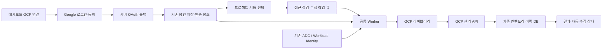

# GCP 대시보드 연결 구현 계획

- 작성일: 2026-09-24
- 기준: `origin/refactoring`, `c13b5b748c2adc9433ab90e89dbde3e05ecf3386`
- 작업 폴더: `C:/Users/naryu/Documents/BoB_팀프로젝트/CreMore-gcp-dashboard-auth`
- 상태: 저장소 클론·코드 조사·계획 작성 완료. 아래 신규 기능은 아직 구현하지 않았다.

## 1. 목표와 현재 문제

사용자가 대시보드에서 Google 계정 연결을 시작하고, 접근할 프로젝트와 수집 범위를 선택한 뒤 실제 수집 결과를 확인할 수 있게 한다.

현재 공통 Worker, GCP 수집 라이브러리, DB 저장, 주기 수집은 구현되어 있다. 인증은 Worker 실행 환경의 ADC에 의존한다. 실제 사이트에서 확인한 `GCP_ADC_NOT_CONFIGURED`는 Worker가 ADC를 불러오지 못했다는 결과다. 브라우저의 Google Cloud 콘솔 로그인만으로 이 인증이 공급되지는 않는다.

기존 코드에서 확인한 변경 지점:

| 현재 구현 | 확장할 내용 |
| --- | --- |
| GCP adapter는 `adc`, `workload_identity`만 허용하고 `secret_refs`를 거절 | 연결별 Google OAuth 인증 지원 |
| 공통 metadata 모델의 `secret_refs`에는 이미 `refresh_token`, `client_id`, `client_secret` 슬롯이 존재 | 기존 봉인 저장·참조 해석 재사용 |
| Worker는 metadata registry를 통해 GCP 라이브러리 호출 | 인증 선택·주입을 추가하고 기존 수집·저장 흐름 재사용 |
| 공급자 관리 화면에 범위 문자열과 ADC 설명 노출 | Google 연결 → 프로젝트 선택 → 접근 점검 → 수집 마법사 |
| GCP Cloud Storage 소스와 credential 인벤토리의 등록 경로가 분리 | 사용자 목적을 먼저 선택하고 올바른 프로젝트·버킷 필드에 연결 |

새로운 GCP 서버나 GCP 전용 Docker는 만들지 않는다. 공통 제품 안에서 GCP 라이브러리 함수를 호출하는 구조를 유지한다.

## 2. 권장 인증 방식

### 대시보드 연결: Google OAuth

팀 실험·사용자가 관리하는 연결에는 Google OAuth 웹 서버 흐름을 추가한다. Google이 로그인과 동의를 처리하고, CreMore 서버가 승인 코드를 교환한다. 갱신 토큰을 서버에 봉인해 Worker가 사용하는 방식이다. 지속 접근에는 offline access를 요청하고 승인된 범위를 확인한다. [Google 웹 서버 OAuth 문서](https://developers.google.com/identity/protocols/oauth2/web-server)

CreMore 사이트에 로그인하는 인증과 GCP API 접근 승인은 별도로 관리한다. Google 계정 연결 성공, 프로젝트 권한 확인, 첫 수집 성공도 각각 다른 상태로 표시한다.

### 무인 운영: 기존 ADC / Workload Identity

장기 무인 운영에는 실행 환경의 서비스 계정 또는 Workload Identity Federation을 사용한다. 대시보드는 설정 현황·필요한 값·점검 결과를 안내한다. WIF는 외부 워크로드의 신원을 Google 접근으로 연결하는 방식이며 실제 배포 환경과 신뢰 설정이 필요하다. [Google WIF 문서](https://docs.cloud.google.com/iam/docs/workload-identity-federation)

사용자 OAuth는 재인증이 필요할 수 있다. 외부 앱의 Testing 상태에서는 이번 용도의 refresh token이 7일 후 만료될 수 있고, 조직의 세션 정책도 재인증을 요구할 수 있다. 화면에 재연결 기능을 포함하고 이를 무기한 동작하는 서버 인증으로 설명하지 않는다. [Google 토큰 만료·세션 정책 설명](https://developers.google.com/identity/protocols/oauth2#expiration)

## 3. 사용자 화면과 동작

1. **GCP 연결**: credential 인벤토리, Secret Manager, Cloud Storage 콘텐츠 중 목적 선택.
2. **인증 방법 선택**: Google 계정 연결 / 운영 서버 인증 사용.
3. **Google 승인**: 일반 브라우저에서 계정 선택과 동의 진행 후 대시보드 복귀.
4. **프로젝트 선택**: 접근 가능한 프로젝트 목록, 검색, 여러 프로젝트 선택, ID 직접 입력 제공.
5. **수집 범위 선택**: 메타데이터, 관계·사용 증거, 선택적 값 수집과 저장, 수집 주기 확인.
6. **접근 점검**: 선택한 기능별 성공·권한 부족·API 미활성화·확인 불가 표시.
7. **연결 완료 및 첫 수집**: 실제 Worker에서 작업 실행 후 인벤토리로 이동.
8. **운영 관리**: 최근 성공, 다음 실행, 부분 실패, 재인증, 일시 중단, 연결 해제 표시.

프로젝트 목록은 `projects.search`로 조회 가능한 범위만 보여준다. 이 API는 호출자에게 `resourcemanager.projects.get` 권한이 있는 프로젝트를 반환하며, 조직 전체 목록을 보장하지 않는다. 목록 조회가 불가능해도 ID 직접 입력과 해당 프로젝트의 실제 API 점검을 제공한다. [Resource Manager projects.search](https://docs.cloud.google.com/resource-manager/reference/rest/v3/projects/search)

여러 프로젝트를 선택하면 프로젝트별 연결·수집 상태를 만든다. 한 프로젝트의 실패 때문에 다른 프로젝트가 실패한 것으로 보이지 않게 한다. 새 프로젝트를 자동으로 수집 범위에 추가하지는 않는다.

## 4. 구현 단위와 담당 경계

| 단계 | 구현 내용 | 주된 경로 | 완료 기준 |
| --- | --- | --- | --- |
| 1. 인증 계약 | `google_oauth` 인증 유형, 연결별 인증 참조·상태, 기존 ADC 호환 | `cremore/coverage/metadata_models.py`, GCP `metadata/descriptor.py`, `metadata/adapter.py` | 기존 연결을 변경 없이 읽고, 잘못된 인증 조합을 거절 |
| 2. Google OAuth | 승인 URL, 코드 교환, 계정 확인, 토큰 갱신, 재연결 | `gcp/backend/cremore_gcp_provider/`의 새 OAuth 모듈 | 모의 Google 응답으로 로그인·갱신·거절·만료 검증 |
| 3. API·저장 | 시작/콜백/상태 API, 일회용 OAuth 세션, 봉인 인증 저장 | `cremore/api/`의 얇은 GCP 라우트, 공통 DB·secretstore | 여러 API 인스턴스·재시작에도 세션 검증과 상태 전환 일관성 유지 |
| 4. Worker 연결 | OAuth/ADC별 토큰 공급, 프로젝트 조회·접근 점검, 기존 수집 호출 | GCP backend, `cremore/coverage/metadata_auth.py`, `collector_runtime.py`, `metadata_job.py` | ADC가 없는 Worker에서도 승인된 OAuth 연결로 합성 수집·DB 저장 성공 |
| 5. 대시보드 | 연결 마법사, 프로젝트 선택, 점검표, 재인증·중단 | `gcp/web/` 새 연결 컴포넌트, 공통 `provider-inventory.tsx` 통합 | 로컬 대시보드에서 연결부터 수집 결과까지 한 흐름으로 진행 |
| 6. 소스 일관성 | GCS catalog·자격증명 점검·승인된 콘텐츠 수집에도 같은 인증 방식 적용 | GCP `source.py`, `content.py`, 공통 source 비밀 해석·Worker factory | OAuth 연결 후 GCS 경로가 다시 ambient ADC만 찾지 않음 |
| 7. 배포·문서 | OAuth 앱 설정, 콜백·프록시·환경변수·봉인 키 전달, 재연결 사용법 | `.env.example`, Compose/Helm, GCP 통합 가이드 | 기존 배포와 새 배포에서 설정 누락을 명확히 진단 |

공급자별 기능과 UI는 GCP 폴더가 소유한다. 인증 유형, API 권한, DB, 공통 Worker 계약 변경은 플랫폼 경계에도 반영해야 한다. GCP 폴더만 수정하는 작업으로 제한하지 않는다.

### 재사용할 계약

- `sealed:v2` 봉인 저장과 `SecretResolver`를 사용한다. 로그인 토큰 저장을 새 평문 파일로 구현하지 않는다.
- metadata `secret_refs`의 기존 슬롯으로 OAuth 갱신 정보 참조를 전달한다. client 설정은 운영자가 관리하고 임의 endpoint 입력을 받지 않는다.
- 요청한 인증 방식이 실패하면 다른 계정의 ADC로 조용히 전환하지 않는다.
- 기존 GCP adapter의 토큰 주입 지점과 공통 `CollectionContext`의 수명 관리에 맞춰 연결별 인증을 공급한다.
- 기존 페이지 예산, 취소, lease, revision 검사, 부분 수집, fenced commit을 유지한다.
- 기존 값 수집·평문 보관 선택은 그대로 지원하되, CreMore 자체 연결에 쓰는 OAuth 토큰은 별도의 봉인 저장 경계를 사용한다.

### OAuth 세션과 연결 수명

- 시작 요청은 기존 관리자 인증을 확인한다. 일회용 state와 브라우저 결합 정보, 요청자, 목적, 만료 시각을 공유 DB에 저장한다.
- 콜백은 정확한 redirect URI, state, 브라우저·요청자 결합, 재사용 여부를 검증한다. PKCE와 계정 식별 검증은 사용하는 Google OAuth 라이브러리 계약에 맞춰 적용한다.
- 토큰 교환은 서버에서 처리한다. 승인 코드가 포함된 콜백 query, access token, refresh token을 프록시·앱 로그에 기록하지 않는다.
- 임시 인증은 프로젝트 연결 확정까지 짧은 TTL로 보관하고, 완료·취소·만료 시 정리한다. 프로세스 메모리만으로 OAuth 세션을 보관하지 않는다.
- 연결 갱신 시 revision을 올려 이전 인증으로 실행 중인 작업의 결과가 새 설정에 잘못 반영되지 않게 한다.
- 재인증이 필요한 오류와 네트워크 일시 실패를 구분한다. 재인증 필요 상태에서는 반복 실패하는 예약 수집을 중지하고 연결 버튼을 제공한다.
- 프로젝트 연결의 수집 중단과 Google 앱 승인 철회를 분리한다. 같은 Google 승인에 연결된 프로젝트가 여러 개라면 승인 철회의 영향 범위를 먼저 표시한다.

## 5. 접근 점검과 표시할 상태

인증 상태와 수집 상태를 분리한다.

- 인증: 미연결 → 승인 진행 → 인증 확인 → 접근 점검 → 사용 가능 / 재인증 필요 / 권한 부족.
- 수집: 실행 전 → 대기 → 실행 → 완료 / 일부 완료 / 실패.

OAuth 동의는 IAM 권한 부여와 같지 않다. 선택한 프로젝트와 기능에 대해 실제 Worker가 읽기 API를 호출해 확인한다. 상태 화면에는 서비스 계정·키 목록, API 키 목록, Secret·버전 목록, 로그·지표, 선택적 값 접근을 구분한다. 목록 읽기 성공만으로 모든 Secret 값 접근이 가능한 것으로 표시하지 않는다.

프로젝트 단위 수집 기능에는 API에 따라 넓은 Google OAuth scope가 필요할 수 있다. 구현 첫 단계에서 기능별 공식 API scope를 확인하고, 화면에 요청 범위와 실제 프로젝트 IAM 권한의 차이를 설명한다. OAuth 연결을 위해 Owner 역할을 자동 부여하지 않는다.

미활성화 API 또는 권한 부족이 확인되면 해당 프로젝트의 설정 링크와 필요한 권한을 제공한다. 변경 승인 없이 IAM/API 설정을 자동 수정하는 흐름은 포함하지 않는다.

## 6. 최초 운영자 설정과 배포 조건

Google 연결 버튼을 제공하려면 배포 운영자가 최초 한 번 다음을 준비해야 한다.

1. Google OAuth 동의 화면과 Web application OAuth client.
2. 실제 사이트의 정확한 HTTPS 콜백 URI와 개발용 콜백 URI. 서로 다른 환경의 client 설정을 구분한다.
3. 서버의 OAuth client ID·secret, 외부 공개 origin, 기존 봉인 키 또는 KMS 접근.
4. API와 Worker의 동일 DB·호환 코드 버전·봉인 키 접근, Google 인증/API endpoint로의 통신.
5. 테스트 사용자와 앱 게시 상태, 필요한 경우 Google의 검증 절차.

콜백을 위해 기존 API 전체의 인증이나 CSRF 검사를 해제하지 않는다. Next 프록시와 oauth2-proxy를 포함한 실제 경로에서 전용 콜백과 세션 처리를 검증한다. 일반 Chrome/Edge에서도 흐름을 확인한다.

설정이 없는 배포에서는 `Google 연결 설정 필요`와 운영자 설정 안내를 보여준다. 버튼을 눌러도 무조건 성공하는 것으로 표시하지 않는다. 서비스 계정 비공개 키 발급·업로드는 기본 연결 절차에 포함하지 않는다.

현재 실제 서버의 실행 방식·환경변수·배포 권한은 확인되지 않았다. 코드와 로컬 화면까지 준비한 후, 해당 서버에 OAuth 앱 설정과 변경 코드를 반영해야 실제 사이트에서도 사용할 수 있다.

## 7. 검증과 완료 조건

### 합성 데이터 검증

- ADC가 없는 테스트 Worker에서 OAuth 연결 → 접근 점검 → GCP metadata 수집 → DB → 대시보드 조회.
- 토큰 만료 후 갱신, 동의 거절, 필요한 범위 미승인, 갱신 토큰 미반환·회수, 조직 재인증 요구.
- state 만료·재사용·다른 브라우저·다른 관리자 요청의 거절, 콜백 redirect 검증.
- 연결 A와 B의 계정·프로젝트·인증정보가 섞이지 않음. OAuth 실패 시 ADC로 전환되지 않음.
- 프로젝트 여러 개의 독립적인 부분 실패, 목록 조회 불가 시 직접 입력, API별 실패 설명.
- 여러 Worker·재시작·재연결·중단 중에도 중복 작업과 오래된 설정의 commit을 방지.
- 기존 ADC/WIF 연결, 다른 공급자, GCS scope 승인, 인벤토리 값 저장 설정 회귀.
- 로그·일반 API·checkpoint·export에 연결용 토큰이 포함되지 않음.

### 로컬 대시보드 검증

- 실제 Next 화면에서 한국어/영어, light/dark, 키보드 접근, 모바일 폭 확인.
- 정상 연결과 재인증·권한 부족·부분 수집 화면을 모의 OAuth/API로 검증.
- OAuth 앱 설정 후 실제 Google 승인은 사용자가 수행하고, 명시된 실험 프로젝트로 첫 수집과 다음 예약 실행을 확인.

### 완료 기준

사용자는 터미널에서 gcloud를 실행하거나 로컬 ADC 파일을 복사하지 않고, 대시보드에서 연결한 Google 계정으로 선택한 프로젝트의 실제 수집 결과를 볼 수 있어야 한다. 장기 무인 운영을 선택한 경우에는 별도로 구성한 Workload Identity의 Worker 점검과 예약 수집을 확인한다.

코드·로컬 테스트 완료, 배포 완료, 실제 Google 연동 완료를 각각 보고한다. Google 앱 설정이나 서버 반영이 남아 있으면 전체 완료로 표시하지 않는다.

## 8. 권장 진행 순서

1. 별도 기능 브랜치에서 인증 모델·OAuth·Worker 통합을 먼저 구현한다.
2. GCP 연결 마법사를 추가하고 로컬 API·Worker·대시보드로 연결한다.
3. GCS 경로와 기존 ADC 회귀를 검증하고 사용 설명서를 갱신한다.
4. Google OAuth 앱의 구체적인 설정값과 배포 변경안을 준비한다.
5. 실험 프로젝트에서 사용자의 Google 승인 후 실제 수집을 검증한다.
6. 리뷰·배포를 거쳐 `test.cremore.site`에서 첫 수집·다음 예약 실행·재연결을 확인한다.

이 계획을 바탕으로 `codex/gcp-dashboard-oauth`에서 OAuth API·연결 세션·Worker 인증·대시보드 연결 화면을 구현했다. 적용 및 검증 범위는 [GCP Google 연결 설정·사용 설명서](GCP_DASHBOARD_OAUTH_KO.md)를 따른다. Google OAuth 앱 생성과 실서버 배포·실제 Google 동의를 통한 수집 확인은 운영 환경에서 별도로 진행한다.
