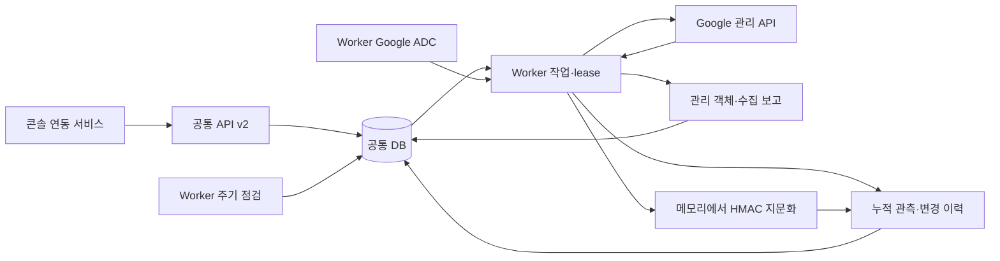

# GCP 통합 기술 명세와 사용 설명서

공통 API·worker·DB에 GCP 수집기를 통합한 경로다. 2026-09-24 공급자 디렉터리 이동을 반영했다.
별도 독립 실행기는 없다(2026-09-27 삭제). 이 문서는 로컬 구현을 설명하며 실제 사이트의 배포·GCP 인증 성공을 보증하지 않는다. 9절의 과거 검증 결과는 당시 기록으로 구분한다.
2026-10-02부터 GCP 원문 저장·관리자 값 조회를 폐기했다. 수집 원문은 메모리에서만 처리하며,
과거 저장 기능을 사용한 설치는 아래 이관 절차로 기존 값과 복제본을 별도 정리해야 한다.

## 1. 연결이 되었는지 판단하기

프로젝트 등록, Worker 인증, 수집 결과는 서로 다른 상태다.

| 화면 또는 상태 | 의미 |
|---|---|
| 연결 프로필 등록 / PENDING | 수집할 프로젝트를 저장함. 인증 성공 여부는 아직 미확인 |
| 접근 점검 작업 완료 | 점검 절차가 종료됨. 내부 결과가 판정 불가일 수 있음 |
| 연동 서비스의 권한 확인 · 수집·탐지 현황의 성공 실행 | 이 연결의 현재 설정으로 관리 API를 읽은 기록이 있음 |
| COMPLETE | 요청한 수집 범위를 완료함 |
| PARTIAL | 일부 API·값·정규화가 미완료. source별 사유를 확인해야 함 |
| FAILED | 해당 실행 실패. 이전에 저장한 관측은 이력으로 보존됨 |

웹 브라우저의 Google Console 로그인으로 서버의 worker가 인증되지는 않는다. ADC는 환경변수가 지정한 파일, 로컬 ADC 파일, 실행 환경에 연결된 서비스 계정 순서로 인증정보를 찾는다. `gcloud auth login`과 `gcloud auth application-default login`도 별개다. [Google ADC 공식 설명](https://docs.cloud.google.com/docs/authentication/application-default-credentials)

GCP 프로젝트 소스의 접근 점검은 IAM 서비스 계정 목록을 한 페이지, 최대 한 항목만 조회한다. GCS 버킷 소스의 점검은 기존 Storage 경로를 사용한다. IAM 점검 성공만으로 Secret 값 접근이나 GCS 본문 읽기 권한까지 확인한 것은 아니다.

## 2. 실행 경로



- `gcp/backend/cremore_gcp_provider/gcp_auth.py`: GCS와 인벤토리의 ADC 처리 및 고정 오류 코드.
- `gcp/backend/cremore_gcp_provider/metadata/`: 범위·요청 제한, 수집 단계, 값 읽기, 정규화.
- `gcp/standalone/cremore_gcp/`: 제품이 재사용하는 식별자·payload 검증·값 reader·매칭 함수. 같은 wheel에 포함하며 제품은 CLI 프로세스 없이 직접 호출한다.
- `gcp/backend/cremore_gcp_provider/source.py`·`content.py`: 콘텐츠 소스 설정·작업 변환과 GCS 본문 수집.
- `cremore/coverage/metadata_job.py`: 페이지별 작업 lease 검증, DB·체크포인트 원자 저장.
- `cremore/coverage/gcp_store.py`: 누적 객체와 원문 없는 관측 변경 저장.
- `cremore/coverage/scheduling.py`: DB 기반 자동 수집 및 중복 작업 방지.
- `cremore/api/gcp_coverage.py`: 기존 소스 연결 및 GCP 조회 API.
- 화면: GCP 전용 UI 폴더는 없다. 콘솔(`web/console/`)이 연결 마법사를 descriptor로 그리고, Google 로그인은
  `web/console/gcp-oauth.ts`, 돌아오는 페이지는 `web/app/(console)/gcp/oauth/callback/page.tsx`가 맡는다.

기존 `cremore.gcp_auth`·`cremore.coverage.providers.gcp` import는 호환 경로다.
새 구현은 위 GCP 소유 경로를 사용한다. 제품 라이브러리는 루트 wheel에 함께 설치하며,
재사용 함수와 제품 adapter의 담당 경계는 [GCP 모듈 안내](../../gcp/README.md)에 있다.

API 서버와 worker는 같은 DB를 사용해야 한다. 실제 Google 요청은 worker가 수행한다. 모든 실행은 지정한 프로젝트 하나로 제한되며, 대상 범위를 바꾸려면 연결 설정 또는 새 연결을 사용한다.

## 3. 수집 범위

| 종류 | 수집 내용 | 값 수집 제한 |
|---|---|---|
| 서비스 계정 | email, unique ID, 표시 이름, 사용 중단 상태 | 계정 자체는 키가 아님 |
| 서비스 계정 키 | 키 ID, 종류, 알고리즘, 유효 기간, disabled·노출 관련 메타데이터 | 공개키 조회는 가능. 기존 private key 원문 재다운로드는 불가 |
| API 키 | 리소스 이름·UID·이름·제한·생성·갱신·삭제 상태 | 별도 `getKeyString` 권한이 있는 키의 문자열 |
| Secret | 글로벌 및 설정한 리전의 항목·생성·버전 별칭 등 | 비어 있는 Secret 항목에는 값이 없음 |
| Secret 버전 | 모든 반환 버전의 번호·상태·생성·폐기 시각 등 | ENABLED 버전만 접근. DISABLED·DESTROYED는 상태만 기록 |
| 선택적 관계 | 접근 로그, API 키 사용 metric, IAM allow 정책 | `relations` capability 필요. 권한·로그 기간·제공 범위 제한 |

API 키 문자열은 `apikeys.keys.getKeyString` 권한이 필요하다. [공식 API 문서](https://docs.cloud.google.com/api-keys/docs/reference/rest/v2/projects.locations.keys/getKeyString)

Secret 버전의 목록 조회와 값 접근은 별도 권한이다. 값 접근에는 `secretmanager.versions.access`가 필요하다. [공식 Secret 접근 문서](https://docs.cloud.google.com/secret-manager/docs/access-secret-version)

기존 서비스 계정 키 조회 API는 공개키를 반환한다. [공식 키 조회 문서](https://docs.cloud.google.com/iam/docs/reference/rest/v1/projects.serviceAccounts.keys/get)

수집기는 API가 반환하지 않은 키나 발급 당시 저장하지 않은 비공개 키를 복원하지 않는다. OAuth 액세스·리프레시 토큰 전체를 열거하는 기능도 없다. 여러 ENABLED 버전이 있다고 해서 모두 현재 배포된 값이라는 뜻은 아니다.

### 값 읽기와 변경 관측

연결 마법사의 `read_values` 또는 수집 설정의 `include_values=true`는 승인된 값을 메모리에서 읽어
지문화하는 선택이다. 값 읽기 capability와 공급자 권한도 있어야 한다. 수집 원문은 DB·파일·로그·작업·
체크포인트에 보관하지 않으며, 가역 암호화나 Base64로 바꿔 보관하는 것도 금지한다.
관리자가 공급자 접속용으로 입력하는 인증 자격증명의 봉인 저장은 이 수집 원문 정책과 별도다.

기존 `value_match`의 HMAC 대조는 유지한다. 성공적으로 읽은 payload에는 별도의 비공개 HMAC을 계산해
값 변경을 관측한다. 바이너리와 빈 값도 포함하고 scheme·key ID가 같은 관측끼리만 변경을 판단한다.
키나 scheme이 달라 비교할 수 없는 지문을 값이 바뀌었다는 근거로 쓰지 않는다. 비공개 지문은 공개 응답·
export에서 제외하며 필요한 메타데이터와 원문 없는 변경 이벤트만 남긴다.

읽기에 성공해 변경 지문을 계산했더라도 자격증명으로 인식하지 못하면 기존 대조에는 `UNRESOLVED_ITEMS`가
남을 수 있다. 값의 변경 관측은 발급 자격증명과의 값 일치나 현재 인증 성공을 입증하지 않는다.

`store_values`·`keep_values` 옵션과 관리자 `gcp-values` 조회 API는 제거했다. 새 API 요청에
`store_values`를 명시하면 거절한다(`false`도 넣지 않는다). 예전 저장 spec의 bool `store_values`는 읽을 때
폐기하고, 이전 공급자 계획의 `keep_values`는 원문 저장을 다시 켜지 못한다.

### 과거 원문 저장 설치의 이관

코드 업그레이드는 기존 DB의 원문 행을 자동으로 지우지 않는다. 이전 버전은 UTF-8 원문과 Base64 값을
`gcp_values`에 보관했으며, 공급자에서 삭제된 비밀의 과거 값도 남아 있을 수 있다.

1. API·worker를 모두 중지하고 이전 버전이 다시 값을 쓰지 않도록 한다. 대상 설치의 DB 설정을 확인하고
   `DATABASE_URL` 환경변수로 전달한다. 접속 자격증명을 명령 인자나 로그에 넣지 않는다.
2. 저장소 루트에서 `python -m cremore.db.purge_gcp_values`로 정리 대상 건수만 확인한다.
   이 명령은 원문을 출력하지 않는다.
3. 삭제할 설치가 맞고 모든 작성 프로세스가 중지되었음을 확인한 뒤
   `python -m cremore.db.purge_gcp_values --apply --offline`을 실행한다.
   다시 건수를 확인하고 새 버전으로만 API·worker를 시작한다. 이 절차는 원문 값 정리이며 finding·감사 이력을 삭제하지 않는다.
4. DB 행 삭제와 별개로 백업·스냅샷·WAL·복제본·기존 내보내기 파일에 남은 원문을 확인한다.
   운영 환경의 보관·폐기 절차에 따라 정리하고, 이전 백업을 복구했다면 서비스를 켜기 전에 다시 정리한다.
   논리적인 행 삭제만으로 디스크와 모든 복제본의 원문 제거가 완료되었다고 판단하지 않는다.

이 문서의 변경으로 운영 DB나 백업 정리가 실행되지는 않는다. 관리자는 실제 정리 대상·실행 결과와
남은 복제본을 따로 기록한다. 폐기된 원문 조회 API를 호출하던 클라이언트도 제거해야 한다.

## 4. Worker 인증과 배포

처음 설치하는 개발자는 [ADC 설정 빠른 시작](GCP_ADC_SETUP_KO.md)의 `scripts/gcp-adc.ps1`로 로그인·로컬 Docker 실행·Worker 인증 확인을 순서대로 진행할 수 있다.

### 로컬 개발

Python 3.12 이상에서 저장소 루트를 기준으로 설치한다.
디렉터리 이동을 받은 기존 개발 환경도 editable install을 다시 실행한다.

```powershell
python -m pip install -e ".[gcp]"
gcloud auth application-default login
gcloud auth application-default set-quota-project YOUR_PROJECT_ID
```

Windows 로컬 ADC의 기본 경로는 `%APPDATA%\gcloud\application_default_credentials.json`이다. 인증 파일이나 토큰을 Git에 추가하지 않는다. 실제 worker가 다른 사용자·컨테이너·서버에서 실행되면 그 환경에서도 ADC를 제공해야 한다.

### Docker Compose

기존 설치의 DB·API 설정을 유지하고, Docker 호스트에 있는 ADC 파일을 worker에 마운트한다.

```powershell
$env:GCP_ADC_FILE = Join-Path $env:APPDATA 'gcloud\application_default_credentials.json'
$env:GCP_QUOTA_PROJECT = 'YOUR_PROJECT_ID'
docker compose -f docker-compose.yml -f deploy/compose/gcp.yml up -d --build api worker web
```

Linux 서버에서는 `GCP_ADC_FILE`에 서버상의 절대 경로를 지정한다. 파일이 없으면 배포가 실패하며 빈 경로를 자동 생성하지 않는다. API/web에는 이 파일을 마운트하지 않는다. 서버 자동 운영에는 실행 환경의 연결된 서비스 계정 또는 운영자가 구성한 Workload Identity Federation을 사용한다. WIF 설정 파일만 옮기고 그 파일이 참조하는 credential source를 제공하지 않으면 인증할 수 없다.

### Kubernetes / Helm

기존 ADC 또는 external-account 설정을 담은 Secret을 운영자가 준비한 경우:

```yaml
gcp:
  adcSecretName: cremore-gcp-adc
  adcSecretKey: adc.json
  quotaProject: YOUR_PROJECT_ID
```

worker만 `/run/gcp/adc.json`으로 마운트한다. GKE Workload Identity를 사용할 경우 `adcSecretName`을 비워 두고 기존 `serviceAccounts.worker` 설정과 클러스터의 신원 연결을 사용한다. WIF가 별도 projected token 파일을 참조하는 경우 해당 token volume은 설치 환경에서 추가로 제공해야 한다. 이 차트는 Google IAM 역할·WIF trust·Secret을 자동 생성하지 않는다.

### 필요한 API와 권한

기본 수집은 IAM, API Keys, Secret Manager 및 Service Usage API의 프로젝트별 조회 권한을 사용한다. 주요 권한은 `iam.serviceAccounts.list`, `iam.serviceAccountKeys.list`, `iam.serviceAccountKeys.get`, `apikeys.keys.list`, `apikeys.keys.getKeyString`, `secretmanager.secrets.list`, `secretmanager.versions.list`, `secretmanager.versions.access`, `serviceusage.services.get`이다. 리전·관계 수집은 해당 endpoint의 추가 권한이 필요하다. 전체 권한은 선택한 capability와 실제 오류 보고를 기준으로 확인한다.

API 활성화·IAM 부여는 이 수집기가 수행하지 않는다. 권한이 없는 항목은 읽지 못한 이유와 함께 기록한다. 목록 권한만 있으면 메타데이터는 보일 수 있지만 값 읽기와 지문 대조는 완료되지 않을 수 있다.

## 5. 화면 사용 순서

1. 배포된 worker에 ADC를 제공하고 API·worker·web을 같은 코드 버전으로 재배포한다.
2. 관리자가 콘솔의 **연동 서비스**에서 **Google Cloud**를 고르고 연결 마법사에서 용도(발급 목록·Secret 저장소·노출 검사·조치)와
   범위(프로젝트, 또는 하위 프로젝트를 찾을 조직·폴더)를 정한다.
3. 인증 방식은 **워크로드 신원 또는 서비스 계정(ADC)**을 고른다. Google 로그인은 [Google 연결 설명서](GCP_DASHBOARD_OAUTH_KO.md)를 본다.
4. 수집 주기는 기본 1440분(0이면 요청할 때만)이고 값 읽기는 꺼짐, 삭제된 키 포함은 켜짐으로 시작한다. 원문 보관 선택은 없다. 나중에 연동 메뉴의
   **수집 범위·인증 설정**에서 바꾼다.
5. 연동 메뉴의 **지금 수집**으로 바로 수집한다. 대기·실행 중인 같은 연결의 수집은 다시 시작하지 않는다.
6. **수집·탐지 현황**에서 실행별 source 완료·미완료·오류 사유를, 연동 메뉴의 **연결 대상 현황**(프로젝트 범위 연결, 관리자)에서
   프로젝트의 변경 이력과 관측한 객체를 확인한다. 수집한 자격증명은 **Credential 목록**과 **메타데이터 수집 현황**에 모인다.
7. 자동 수집을 멈추려면 주기를 `0`으로 저장한다. 연결을 사용 중지하면 실행 중 작업도 다음 페이지 저장 전에 변경을 검사한다.

## 6. 자동 추적의 의미

- `schedule_minutes`: 0은 수동, 1~10080은 분 단위 주기. worker가 실행 중이어야 한다.
- `SCAN_SCHEDULES_MODE=disabled`: 설치 전체의 일정 실행 차단. 콘텐츠 스캔 화면의 별도 스케줄 스위치와는 구분된다.
- DB 연결 행 잠금과 실행 중 작업 검사로 여러 worker의 중복 등록을 막는다. 재시작 후에도 DB의 최근 작업·예약 시각을 사용한다.
- `discovered`, `state_changed`, `metadata_changed`, `value_collected`, `value_changed`, `no_longer_listed`를 누적한다. 동일한 관측을 반복해도 이벤트를 반복 생성하지 않는다.
- API가 직접 보고한 disabled/deleted/destroyed를 관측 상태로 보존한다. 완주한 목록에서만 부재를 기록하며, 403·네트워크 오류·페이지 한도로 누락된 항목을 폐기됐다고 판단하지 않는다.
- 이벤트 시각은 수집 시각이다. 두 poll 사이에 생성되고 삭제된 항목은 놓칠 수 있다. 실시간 Audit Log/Pub/Sub 이벤트 구독은 이번 구현에 포함되지 않는다.

## 7. API 계약

경로 앞에는 `/api/v2/coverage`를 붙인다. 기존 CreMore 인증을 사용한다.

| 메서드·경로 | 권한 | 역할 |
|---|---|---|
| `GET /providers` | 로그인 | GCP preset·capability 조회 |
| (없어짐) | — | 연결 등록은 `/api/v1/provider-connections`의 GCP 공급자 연결 4단계([공급자 연결](../ONBOARDING.md)) |
| `PATCH /connections/{id}` | admin | revision과 함께 옵션·활성 상태 변경 |
| `POST /connections/{id}/collect` | analyst 이상 | 수집 작업 접수 또는 진행 중 작업 ID 반환 |
| `GET /connections/{id}` | 로그인 | 현재 설정·최근 작업·수집 결과·GCP 인증 진단 |
| `GET /connections/{id}/gcp?kind=events` | 로그인 | 원문 없는 누적 이벤트와 객체 건수 |
| `GET /connections/{id}/gcp?kind=objects` | 로그인 | 누적 관측 객체 |

페이지 조회는 `offset`·`limit`를 사용하며 객체/이벤트는 최대 500건이다. `gcp-values` 경로와
overview의 `values_storage`·`counts.values`는 제거했다. 한 연결의 과거 범위를 바꿨더라도 원문 없는 누적 관측 이력은 자동 삭제하지 않는다.

예: 운영자 인증을 준비한 API 클라이언트에서 주기만 끄려면, 먼저 연결을 읽고 현재 spec의 `schedule_minutes`를 `0`으로 바꿔 해당 revision과 함께 PATCH한다.

## 8. 오류 해결

| 코드 | 확인할 것 |
|---|---|
| `GCP_ADC_NOT_CONFIGURED` | worker 환경의 ADC 파일·경로·마운트·읽기 권한 |
| `GCP_ADC_REFRESH_FAILED` | ADC 만료·회수, WIF trust·credential source, 재인증 |
| `GCP_AUTH_DEPENDENCY_MISSING` | worker 이미지의 `google-auth[requests]` 설치 |
| `GCP_AUTH_NETWORK_FAILED` | worker에서 Google 인증 endpoint로 나가는 네트워크 |
| `GCP_ADC_TOKEN_UNAVAILABLE` | ADC가 사용 가능한 토큰을 반환하는지 |
| `GCP_AUTHENTICATION_FAILED` / `AUTHENTICATION_FAILED` | Google이 토큰을 거부했는지 |
| `GCP_PERMISSION_DENIED_OR_API_DISABLED` / `PERMISSION_DENIED_OR_API_DISABLED` | 요청한 API 활성화, worker 신원의 해당 리소스 IAM 권한 |
| `GCP_PROJECT_SCOPE_REQUIRED` | 기존 소스에 프로젝트가 있는지. 버킷 이름은 프로젝트 ID가 아님 |
| `GCP_EXISTING_SCOPE_MISMATCH` | 같은 소스 ID의 인벤토리가 다른 범위인지 |
| `GCP_SOURCE_DISABLED` | 인벤토리와 연결된 원본 GCP 소스가 사용 중단 상태인지 |
| `UNRESOLVED_ITEMS` | 값 읽기·자격증명 인식·지문 대조의 미확정 항목. source 보고와 함께 해석 |

## 9. 검증과 남은 운영 확인

오프라인 테스트는 메모리 및 SQLite 저장소에서 API → 작업 queue → worker → Google 모의 응답 → DB → 조회 API를 검증한다. 새 버전, 사용 중단·삭제 상태, 조회 실패 시 이전 상태 유지, 중복 방지, 작업 중 비활성화와 원문 비저장을 다룬다. 아래 2026-09-22 기록의 관리자 값 조회 검사는 폐기 전 기능에 대한 당시 증거다.

저장소 루트에서 실행한다. 아래는 PowerShell 예시다.

```powershell
python -m pip install -e ".[dev,gcp]"
$env:AWS_EC2_METADATA_DISABLED='true'
python -m pytest gcp/backend/cremore_gcp_provider/gcp_auth_test.py cremore/coverage/gcp_integration_test.py gcp/backend/cremore_gcp_provider/metadata/tests cremore/api/metadata_coverage_test.py -q
cd web
node --test tests/console-reach.test.cjs tests/console-gcp-oauth.test.cjs
```

실제 사이트에서 별도로 확인할 항목은 배포 버전, worker ADC 신원, 프로젝트 API·IAM 권한, 첫 실제 수집 결과, 다음 예약 실행이다. 코드 테스트만으로 이 확인을 대신하지 않는다.

### 2026-09-22 통합 당시 로컬 검증 결과

아래 수치는 당시 실행 기록이며 공급자 디렉터리 이동이나 2026-10-02 원문 비저장 변경의 검증 결과를 대신하지 않는다.

- Python: coverage 전체, worker, 관련 collector·metadata API·GCP 인증 테스트 **801 통과, 61 skip, 254 subtest 통과**. Windows의 한글 Git 경로를 읽기 위해 테스트 프로세스에 `PYTHONUTF8=1`을 사용했다.
- 웹: 전체 단위·렌더링 테스트 **462 통과**, TypeScript 및 Next.js 프로덕션 빌드 성공.
- 배포: Helm lint·렌더링 성공, ADC가 worker에만 마운트되는지 확인. Docker Compose 실제 기동은 수행하지 않았다.
- 프로젝트 전체 Python 검사는 로컬 Windows의 RE2 미설치 때문에 기존 사용자 정의 정규식 테스트에서 중단됐다. Linux CI 전체 통과를 별도로 확인해야 한다.
- 로컬 브라우저 검증용 웹 서버 실행은 자동 승인 검토에서 차단돼 시각 검증을 완료하지 못했다. 상세 차단 사유는 제공되지 않았다.
- 실제 GCP에 대한 새 수집·권한 변경·배포는 수행하지 않았다. 배포된 사이트에서 조회한 GCP 프로필은 `PENDING`이었다.
